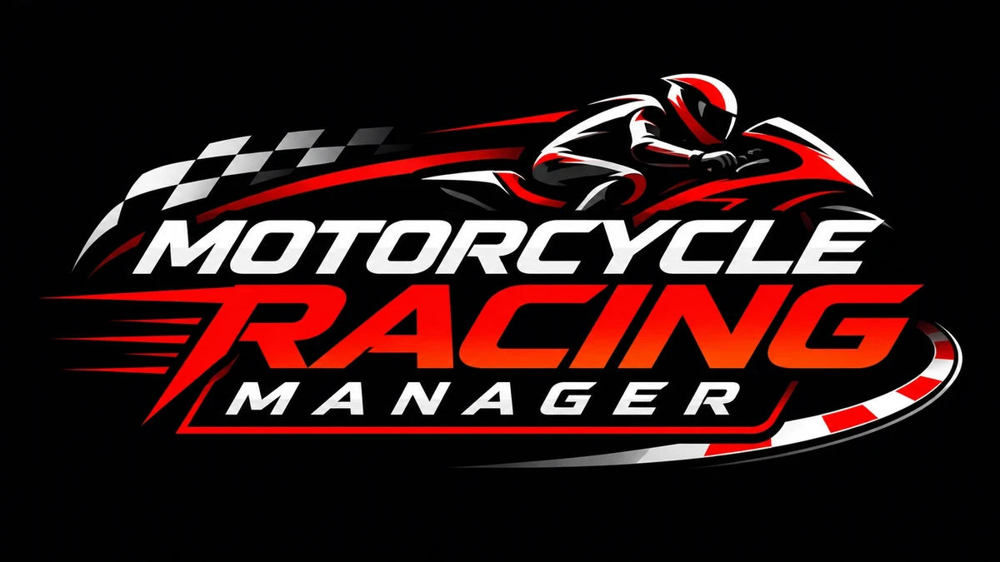

<p align="center"></p>

# Motorcycle Racing Manager

Gioco manageriale di motociclismo che si gioca nel browser. Sei il **manager di una squadra**: non guidi la moto,
ma scegli i piloti, prepari la moto e il weekend, decidi la strategia in gara e fai quadrare i conti. Squadre,
piloti, circuiti, costruttori e marchi sono **inventati**.

Quattro campionati: **MotoGP**, **Moto2**, **Moto3** e **Velocity Rookies Cup**. Puoi guidare una squadra
esistente oppure crearne una tua.

**Versione online** (privata, condivisibile dal menu della pagina): https://claude.ai/artifact/Hm8aBjMgYxqp3obqHN2Bag.
I salvataggi restano nel browser di chi gioca.

## Come si gioca: riepilogo

> Nel gioco c'è una **guida completa a passi**: si apre da sola alla prima carriera, poi dal pulsante **Guida**
> in basso a sinistra o da **Come si gioca** nel menu principale. Con «Mostrami» apre la schermata di cui parla.

### L'obiettivo
Fare punti in campionato, raggiungere l'obiettivo dello sponsor e non restare senza soldi. Il tempo avanza solo
quando lo decidi tu: il **pulsante rosso in alto a destra** indica sempre il prossimo passo («Vai al Gran
Premio», «Vai al weekend», «Chiudi la stagione»).

### Cosa fare, in ordine
1. **Nuova carriera** → scegli categoria e una **squadra cliente** (satellite, indipendente o privata: le
   squadre ufficiali appartengono ai costruttori), poi il **costruttore** che ti fornisce le moto. Ogni
   costruttore offre agevolazioni diverse (moto più veloce, affidabilità, gomme, upgrade scontati o più
   rapidi, contributo alla firma) e chiede un canone annuo. Oppure **Crea la tua squadra**.
2. **Sponsor**: firma il contratto della stagione prima del primo Gran Premio (sicuro, bilanciato o ambizioso;
   più soldi = obiettivo più difficile).
3. **Piloti** e **Mercato**: controlla attributi, morale, forma e contratti; fai offerte (stipendio e anni),
   valuta le controproposte. I piloti sotto contratto si trattano fino al primo Gran Premio e a fine stagione; gli
   **svincolati** in ogni momento. Nella scheda **Personale tecnico** ingaggi capotecnici, ingegneri e meccanici
   svincolati.
4. **Moto e upgrade** (garage): la moto è al centro, intorno i gruppi tecnici con livello, prestazione, usura e
   stato. Scegli la manutenzione (automatica, assistita o manuale), compra ricambi, ordina upgrade alla fabbrica
   (arrivano dopo qualche giorno). In MotoGP: Moto A e Moto B, motori limitati.
5. **Assetto** (nel garage): per ogni pilota, su asciutto e bagnato. Il pilota commenta le regolazioni; un buon
   assetto vale fino all'1,5% di ritmo.
6. **Test pre-stagionali** («Vai al test»): prima del primo GP (MotoGP: 2 test, 3 + 2 giornate; Moto2/Moto3: 3
   giornate; Rookies: 1). Per ogni pilota scegli *Circuito*, *Assetto*, *Passo gara* o *Sviluppo*: i primi tre
   alzano la confidenza con la moto da cui parte ogni weekend (senza test 50, avversari 60), *Sviluppo* rende gli
   upgrade più rapidi ed economici. Ogni giornata costa la trasferta; si può saltare il resto del test.
   Poi **Vai al Gran Premio**: i giorni scorrono fino al weekend.
7. **Prove libere**: scegli gomma e programma di lavoro (*Circuito*, *Assetto*, *Passo gara*). Dopo ogni uscita
   c'è la **riunione tecnica**: confidenza col circuito e con la moto, commenti del pilota, consiglio del
   capotecnico da applicare (hai 45 minuti di lavoro fra una sessione e l'altra), cronologia del weekend.
8. **Qualifiche** (Q1/Q2 o qualifica unica): gomma per il giro secco; l'ingegnere consiglia sempre. Prove e
   qualifiche si seguono nella **schermata tempi** (settori: rosso miglior assoluto, arancio miglior personale,
   grigio più lento); in gara la stessa schermata è la vista «Tempi».
9. **Sprint e gara in diretta** (2D o 3D, da 1× a 16×): cambia in corsa **ritmo** (5 livelli), **mappa
   carburante** (risparmio, standard, prestazione) e **gestione gomme**. Se il carburante finisce il pilota si
   ritira. Gli avversari usano le stesse leve; ci sono penalità, bandiere e guasti. Si può salvare a metà gara.
10. **Dopo la gara**: punti, classifiche (piloti, team, scuderie/costruttori, indipendenti), premi, forma e
    morale, usura della moto, notizie. In **Squadre e piloti** vedi tutte le squadre per costruttore, con i loro
    piloti. Poi di nuovo «Vai al Gran Premio».
11. **Finanze**: entrate (sponsor, premi) e uscite (stipendi, gestione, canone del costruttore, trasferte,
    ricambi, upgrade). Tieni
    d'occhio il saldo mensile in Home.
12. **Il manager**: la squadra ti paga uno stipendio che va nei tuoi soldi personali. Puoi spenderli in corsi
    (negoziazione, rapporti commerciali, gestione tecnica: effetti reali) o investirli nella squadra. Se fai meglio
    delle attese, a fine stagione arrivano **offerte di lavoro** da altre squadre (più soldi, un pilota di punta o la
    moto migliore): tratti lo stipendio e firmi.
13. **Salva** spesso (in basso a sinistra). A fine campionato **Chiudi la stagione**: riepilogo, contratti in
    scadenza, stagione successiva.

### Consigli per i primi Gran Premi
- Firma lo sponsor e ordina un upgrade prima della prima gara; lascia la manutenzione in *Automatica*.
- Nelle libere usa il programma *Assetto* e applica i consigli del capotecnico.
- In gara parti con ritmo normale; alza il ritmo se le gomme e il carburante lo permettono.

Stato del progetto: [docs/report/REPORT.md](docs/report/REPORT.md) · priorità: [docs/ROADMAP.md](docs/ROADMAP.md).

## Sviluppo

Requisiti: Node.js ≥ 22.

```bash
npm install
npm run dev          # app in sviluppo (http://localhost:5173)
npm run build        # build di produzione (apps/client/dist)
npm run check        # lint + controllo tipi + test Vitest
npm run e2e          # carriera completa nel browser con Playwright (richiede la build)
npm run worldgen:report -- <seme>   # riepilogo del mondo generato da un seme
```

Gli screenshot della prova Playwright finiscono in `test-results/screenshots/` (ignorata da Git): sono artefatti
temporanei di verifica, non vanno nel repository.

| Pacchetto | Contenuto |
|---|---|
| `packages/core` | generatore casuale con seme, ID, calendario di gioco, eventi, denaro |
| `packages/data` | schema dello stato di gioco, contenuti originali, generatore del mondo, salvataggi con migrazioni |
| `packages/sim` | motore di gara e di qualifica |
| `packages/game` | `GameEngine`: comandi, weekend, regolamento, economia, garage, assetti, viste per l'interfaccia |
| `packages/persistence` | formato dei salvataggi e archivio |
| `packages/engine-host` | motore nel Web Worker e client con Promise |
| `apps/client` | app React + Vite: design system "Paddock Night", schermate, vista gara 2D/3D |
| `tools/` | prova e2e, report del mondo, generazione locale delle immagini (`tools/portraits/`) |

Confini fra pacchetti controllati da ESLint: `core` ← `data` ← (`sim`, `game`, `persistence`) ← `engine-host` ← `apps/client`.

## Immagini del gioco

Ritratti, foto delle moto delle squadre e immagini dei gruppi tecnici sono generati **in locale e gratis**
(SDXL-Turbo, Stability AI Community License) con gli script in `tools/portraits/`. Inventario, provenienza e
licenze: [docs/ASSETS_E_LICENZE.md](docs/ASSETS_E_LICENZE.md).

## Documentazione

| Documento | Contenuto |
|---|---|
| [docs/GDD.md](docs/GDD.md) | Game Design Document |
| [docs/ROADMAP.md](docs/ROADMAP.md) | Milestone e priorità |
| [docs/ARCHITECTURE.md](docs/ARCHITECTURE.md) | Architettura tecnica e stato effettivo del codice |
| [docs/SIMULAZIONE-INCREMENTALE.md](docs/SIMULAZIONE-INCREMENTALE.md) | Simulazione a passi, strategie in gara, salvataggio a metà sessione |
| [docs/SALVATAGGI.md](docs/SALVATAGGI.md) | Formato dei salvataggi, versioni e migrazioni |
| [docs/SIMULATION.md](docs/SIMULATION.md) | Modello di simulazione e formule |
| [docs/DATA_MODEL.md](docs/DATA_MODEL.md) | Modello dati e convenzioni |
| [docs/REGULATIONS.md](docs/REGULATIONS.md) | Regolamenti delle categorie |
| [docs/TECH_TEAM.md](docs/TECH_TEAM.md) | Squadra tecnica, Moto A/B, briefing |
| [docs/INJURIES_AND_TESTERS.md](docs/INJURIES_AND_TESTERS.md) | Infortuni, sostituti, collaudatori |
| [docs/UI_DESIGN.md](docs/UI_DESIGN.md) | Design system e regole dell'interfaccia |
| [docs/ASSETS_E_LICENZE.md](docs/ASSETS_E_LICENZE.md) | Asset, generazione, licenze |
| [docs/adr/](docs/adr) | Decisioni architetturali (ADR) |

## Regole di sviluppo

Nessun pulsante finto, nessun risultato prestabilito, nessun dato statico nelle schermate operative, sistemi
testati, formule documentate, un ramo e una PR per milestone, nessun merge su `main` senza approvazione.

## Crediti

- Bandiere: [flag-icons](https://github.com/lipis/flag-icons) di Panayiotis Lipiridis, licenza MIT.
- Grafica 3D: [Three.js](https://threejs.org), licenza MIT.
- Carattere: Archivo (Google Fonts), SIL Open Font License.
- Immagini generate con SDXL-Turbo (Stability AI Community License) — vedi docs/ASSETS_E_LICENZE.md.
