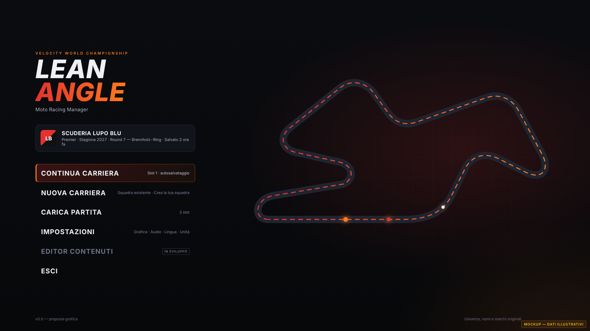
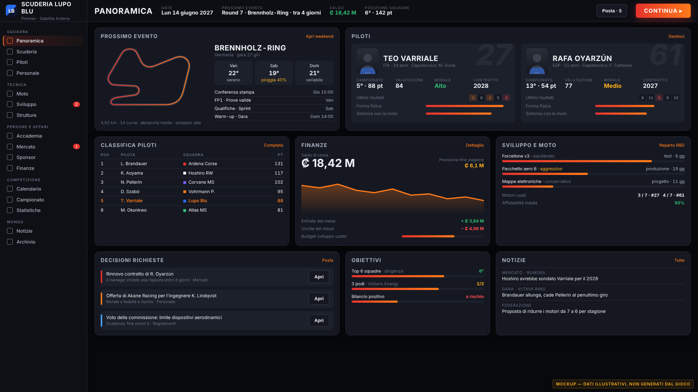
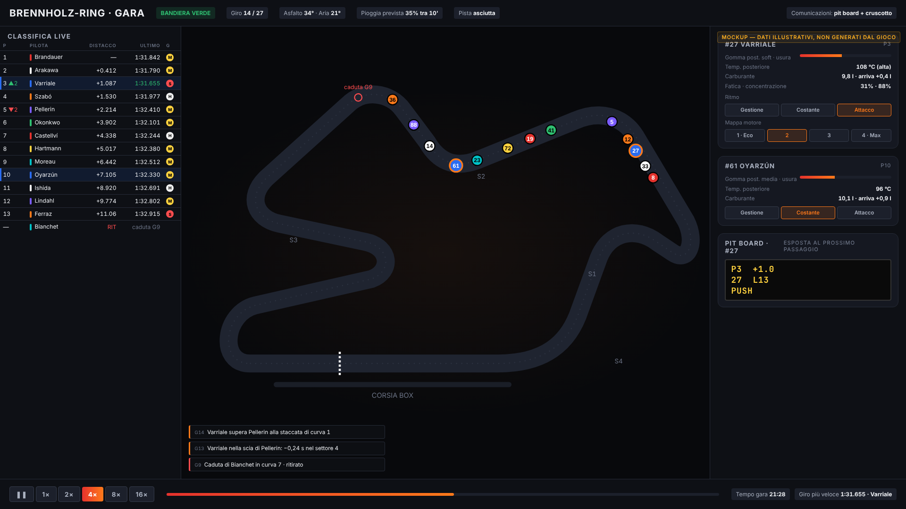
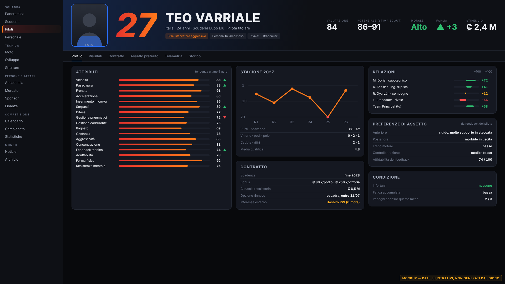
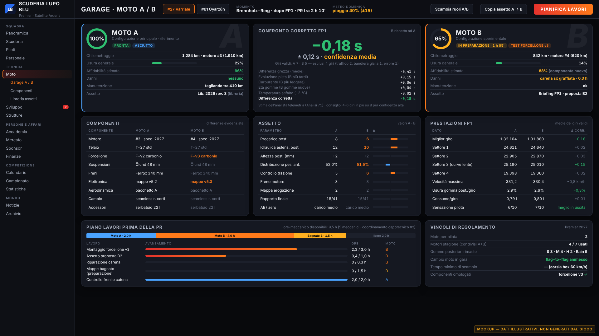
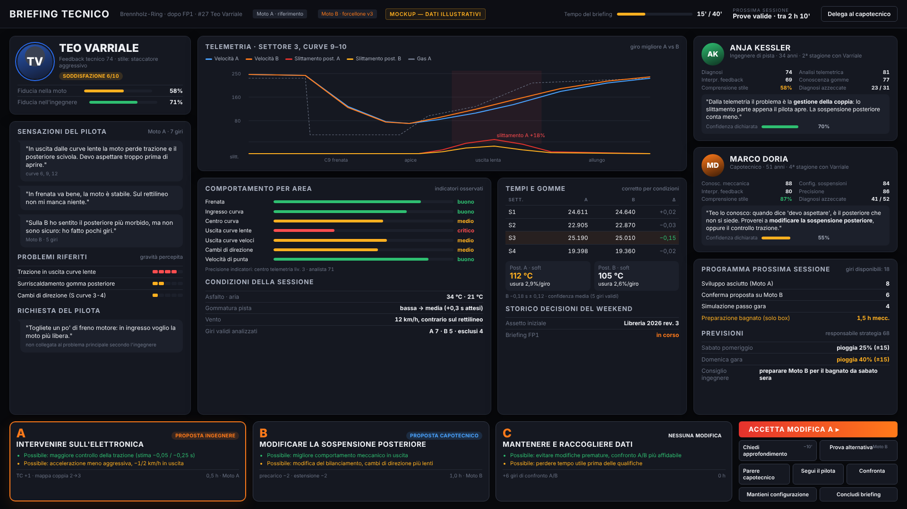
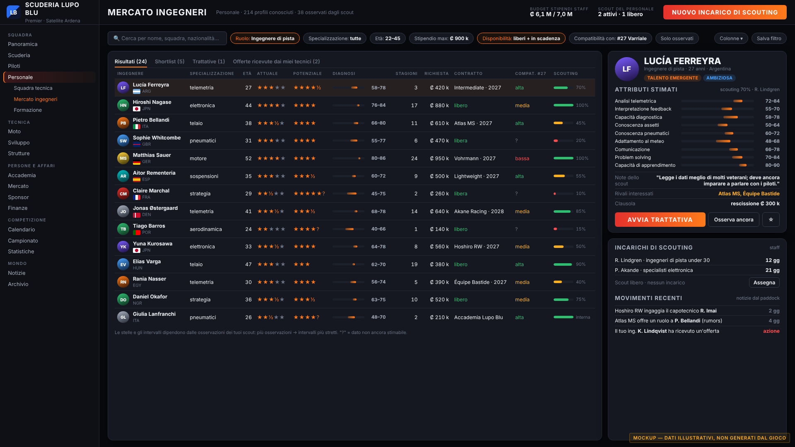
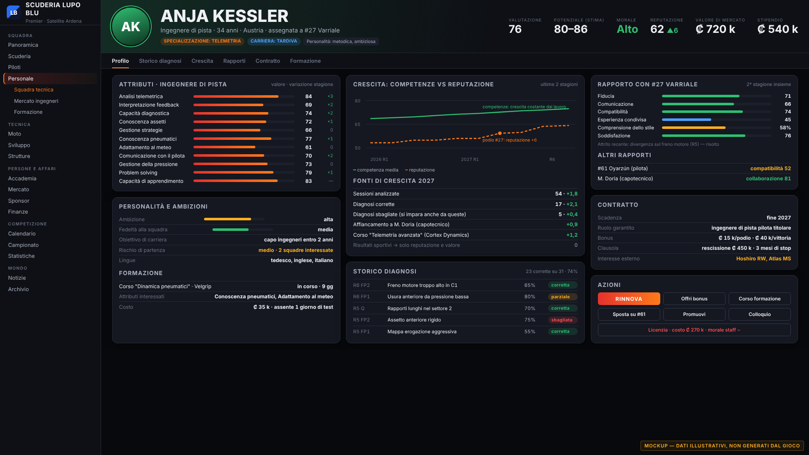
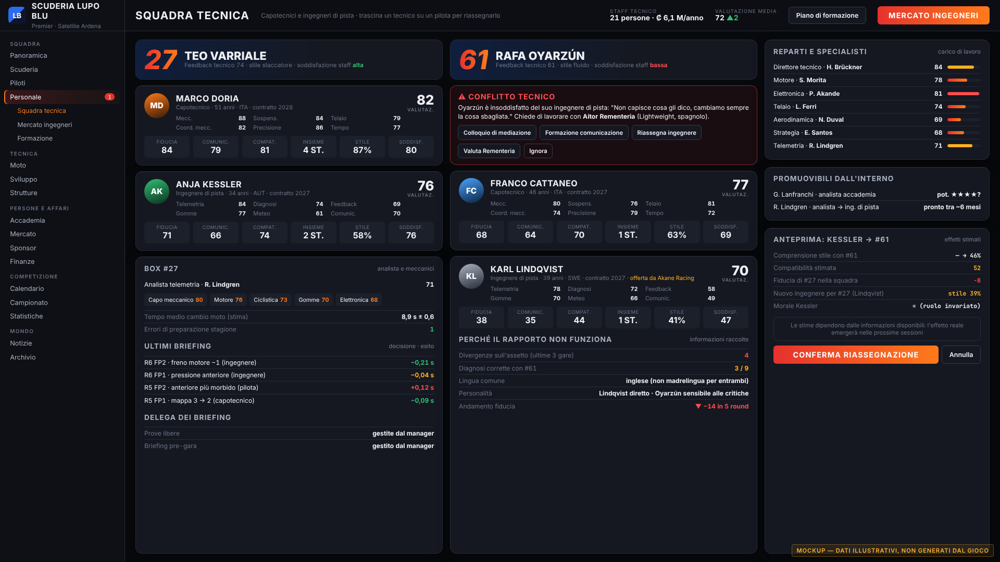

# Proposta grafica e UI

> Stato: **PROPOSTA**. I mockup in `docs/mockups/` sono pagine HTML statiche con **dati
> illustrativi** per valutare lo stile; non sono codice di gioco. Nel gioco ogni valore
> proverrà dallo stato simulato.

## 1. Direzione visiva

**"Pit wall notturno"**: superfici scure stratificate, accenti rosso→arancione usati solo per
ciò che conta (azione principale, selezione, dati della propria squadra), tipografia condensata
corsiva per titoli e numeri di gara, sans-serif leggibile per i dati.

| Elemento | Scelta |
|---|---|
| Sfondo | 4 livelli di grigio-blu molto scuro (`#08090c` → `#1c202b`) per dare profondità senza ombre pesanti |
| Accento | gradiente `#e5322d` → `#ff7a1a`; arancione per link e selezioni, rosso per allarmi/azioni critiche |
| Stati | verde `#2fbf71`, ambra `#ffb020`, rosso `#ff4d4f`, blu `#4aa3ff` (sempre accompagnati da testo o icona, mai solo colore) |
| Titoli e numeri | **Barlow Condensed** (SIL Open Font License), maiuscolo, spaziatura ampia |
| Testo e tabelle | **Inter** (SIL OFL) con cifre tabulari |
| Codice/telemetria | **JetBrains Mono** (SIL OFL) |
| Icone | set SVG proprio a tratto 1,5 px (nessun pacchetto icone esterno obbligatorio) |
| Animazioni | 150–250 ms, easing morbido; numeri che cambiano con transizione; nessuna animazione decorativa durante la gara |

I font saranno inclusi nel pacchetto del gioco (nessun caricamento da Internet).

Token completi: [`docs/mockups/tokens.css`](mockups/tokens.css) (diventeranno `apps/client/src/design-system/tokens.css`).

### Risoluzioni
Layout progettato su 1920×1080 in unità `rem`; la dimensione radice scala a 1440p e 4K
(fattore 1,25 / 2). Larghezza minima supportata 1280×720. Grafici in SVG/Canvas con
`devicePixelRatio` per nitidezza in 4K.

## 2. Menu principale

- A sinistra: marchio, scheda **"Continua"** con anteprima dell'ultimo salvataggio (squadra,
  stagione, round, quando), voci del menu.
- A destra: un circuito del gioco disegnato dai **dati reali del tracciato** con moto
  animate (nel gioco: un replay a bassa velocità di una gara simulata in background).
- Voci: Continua carriera · Nuova carriera (Squadra esistente / Crea la tua squadra) ·
  Carica partita · Impostazioni · Esci. Funzioni non ancora pronte appaiono disabilitate
  con etichetta **"In sviluppo"**, mai come pulsanti attivi.
- Navigazione completa da tastiera e controller (frecce + Invio).

### Flusso "Nuova carriera"
1. Modalità (squadra esistente / crea squadra)
2. Categoria di partenza (Lightweight · Intermediate · Premier)
3. Scelta squadra con confronto: budget, moto, piloti, obiettivi della dirigenza, difficoltà stimata
   — oppure procedura guidata di creazione (identità → tipologia → costruttore → piloti → staff → sponsor → riepilogo)
4. Opzioni: nome carriera, seme del mondo (opzionale), difficoltà, autosalvataggio
5. Generazione del mondo con barra di avanzamento (simulazione delle stagioni storiche)

## 3. Dashboard (Panoramica)

**Struttura della shell (comune a tutte le schermate)**

- **Sidebar** con le 16 voci richieste, raggruppate:
  *Squadra* (Panoramica, Scuderia, Piloti, Personale) · *Tecnica* (Moto, Sviluppo, Strutture) ·
  *Persone e affari* (Accademia, Mercato, Sponsor, Finanze) · *Competizione* (Calendario,
  Campionato, Statistiche) · *Mondo* (Notizie, Archivio). I badge numerici indicano azioni in sospeso.
- **Top bar**: titolo schermata, data di gioco, prossimo evento, saldo, posizione squadre,
  posta, e il pulsante primario **Continua** che avanza il tempo fino al prossimo evento o
  decisione obbligatoria (come nei manageriali sportivi).

**Widget della Panoramica**

| Widget | Contenuto | Fonte dati |
|---|---|---|
| Prossimo evento | mappa circuito, caratteristiche, previsioni meteo con incertezza, programma sessioni | `Round`, `Circuit`, `WeatherForecast` |
| Piloti | posizione, punti, valutazione, morale, contratto, ultimi 5 risultati, forma fisica, sintonia con la moto | `Rider`, `Standing`, `SessionResult` |
| Classifica | prime posizioni + riga della propria squadra evidenziata | `Standing` |
| Finanze | saldo, andamento cassa, previsione di fine stagione, entrate/uscite del mese | `Transaction`, `FinanceForecast` |
| Sviluppo e moto | progetti R&D attivi con fase e tempi, motori usati / limite, affidabilità | `RnDProject`, `Bike`, `Regulation` |
| Decisioni richieste | elementi della posta che bloccano l'avanzamento o hanno scadenza | `InboxItem` |
| Obiettivi | dirigenza, sponsor, costruttore con stato | `Objective` |
| Notizie | ultime notizie e rumors generati dagli eventi | `NewsItem` |

## 4. Weekend di gara — vista 2D

- **Sinistra**: classifica live con distacchi, ultimo giro, mescola, guadagni/perdite di posizioni; i piloti della squadra sono evidenziati.
- **Centro**: mappa 2D dall'alto disegnata dal tracciato del circuito, settori, corsia box, moto numerate nei colori delle squadre, segnalazione di cadute; feed degli eventi prodotti dalla simulazione.
- **Destra**: un pannello per pilota (usura e temperatura gomme, carburante con margine all'arrivo, fatica e concentrazione) e i comandi consentiti dal regolamento: ritmo, mappa motore, **pit board** con anteprima del messaggio.
- **Barra inferiore**: pausa, 1×, 2×, 4×, 8×, 16×, avanzamento gara, giro più veloce.

## 5. Scheda pilota

Intestazione con numero, valutazione, **potenziale stimato come intervallo** (dipende dagli scout),
morale, forma, stipendio. Schede: Profilo, Risultati, Contratto, Assetto preferito, Telemetria, Storico.
Nel profilo: i 17 attributi con tendenza, andamento della stagione, contratto e clausole,
relazioni con staff/compagno/rivali, preferenze di assetto ricavate dal feedback, condizione fisica.

## 6. Squadra tecnica, Moto A/B e briefing (revisione Fase 0)

Schermate per i sistemi descritti in [TECH_TEAM.md](TECH_TEAM.md). Tutti i mockup sono in Full HD 1920×1080.

### 6.1 Garage Moto A / Moto B

Per ogni pilota: stato delle due moto (prontezza, disponibilità, chilometraggio, usura, affidabilità,
danni, manutenzione, assetto), **confronto corretto** B rispetto ad A con l'incertezza e il dettaglio
delle correzioni (evoluzione pista, carburante, gomme, temperatura), componenti e assetto affiancati
con le differenze evidenziate, prestazioni per settore, piano dei lavori con le ore-meccanico
disponibili e vincoli del regolamento (motori condivisi, gomme, flag-to-flag).

### 6.2 Briefing tecnico

- **Sinistra – pilota**: immagine, nome, soddisfazione, fiducia nella moto e nell'ingegnere, sensazioni riportate tra virgolette, problemi con gravità percepita, richieste personali.
- **Centro – analisi**: telemetria A vs B nel tratto critico, comportamento per area (indicatori osservati), tempi per settore corretti, gomme, condizioni della sessione, storico delle decisioni del weekend.
- **Destra – staff**: ingegnere di pista e capotecnico con competenze chiave, comprensione dello stile del pilota, storico diagnosi, ipotesi con **confidenza dichiarata**; programma della sessione successiva e previsioni meteo.
- **Basso – decisioni**: soluzioni A/B/C con vantaggi e svantaggi *possibili* (non garantiti) e pulsanti Accetta modifica, Chiedi approfondimento, Prova alternativa (Moto B), Parere capotecnico, Segui il pilota, Confronta, Mantieni configurazione, Concludi briefing. Tempo del briefing sempre visibile; delega al capotecnico.

### 6.3 Mercato ingegneri

Filtri (ruolo, specializzazione, età, stipendio, disponibilità, compatibilità con un pilota), tabella
con valutazione attuale e potenziale **stimati** dagli scout (intervalli e "?"), stipendio richiesto,
contratto, compatibilità stimata, avanzamento dello scouting; anteprima del profilo con attributi a
intervallo, note dello scout, rivali interessati; incarichi di scouting e movimenti del mercato.

### 6.4 Scheda ingegnere

Attributi del ruolo con variazione stagionale, grafico **competenze vs reputazione** (cresce la
reputazione con i podi, le competenze con il lavoro), fonti di crescita, storico delle diagnosi
(corretta / parziale / sbagliata), personalità e ambizioni, formazione, rapporti con piloti e colleghi,
contratto e azioni (rinnova, bonus, formazione, sposta, promuovi, colloquio, licenzia).

### 6.5 Gestione capotecnici e ingegneri di pista

Un "box" per pilota con capotecnico, ingegnere di pista, analista e meccanici; per ogni coppia
pilota-tecnico i sei valori del rapporto (fiducia, comunicazione, compatibilità, esperienza condivisa,
comprensione dello stile, soddisfazione). Segnalazione dei **conflitti** con le azioni del manager,
reparti specialistici con carico di lavoro, tecnici promuovibili dall'interno e **anteprima degli
effetti** di una riassegnazione prima della conferma.

## 7. Altre schermate chiave (linee guida)

- **Tabelle**: intestazioni fisse, ordinamento, filtri salvabili, colonne configurabili,
  virtualizzazione oltre 100 righe, confronto di due righe.
- **Schede persona**: intestazione con numero/ruolo, attributi a barre con valore e tendenza
  (▲▼), storico, contratto, relazioni.
- **Weekend di gara**: layout a tre colonne — cronometraggio a sinistra, mappa 2D al centro,
  controlli piloti e telemetria a destra; barra delle velocità (pausa, 1×, 2×, 4×, 8×, 16×) in basso.
- **Telemetria**: grafici a traccia sovrapposta per distanza (velocità, gas, freno, piega),
  delta-tempo, confronto pilota A/B, selettore giro.

## 8. Accessibilità
Contrasto minimo AA sul testo, stati mai indicati solo dal colore, dimensione testo regolabile,
modalità per daltonici sui colori di gomme e squadre, riduzione animazioni.
