# Sintesi della proposta

**Repository**: `romeoliva93/motorcycle-manager` · branch
`design/phase-0-proposal` · Pull Request \#1 (in revisione, non
integrata in `main`).

**Stato**: solo progettazione. Nessun sistema di gioco è ancora
implementato; i mockup usano dati illustrativi.

| Tema                            | Proposta                                                                                                                                                                                                                                                                                            |
|---------------------------------|-----------------------------------------------------------------------------------------------------------------------------------------------------------------------------------------------------------------------------------------------------------------------------------------------------|
| Tecnologia                      | TypeScript (monorepo npm) · simulazione in pacchetti puri su Web Worker · React + Vite · Canvas 2D · Tauri 2 per PC · Vitest + Playwright                                                                                                                                                           |
| Architettura                    | simulazione separata dalla UI; comandi validati uguali per giocatore e IA; PRNG con seme (determinismo, replay); stato relazionale in memoria; eventi di dominio                                                                                                                                    |
| Universo                        | federazione IVF, campionato Velocity World Championship; categorie Lightweight 250 cc, Intermediate 800 cc motore unico, Premier 1000 cc; feeder Junior Velocity Cup e Continental Talent Cups; costruttori Ardena, Hoshiro, Takaido, Vohrmann, Corvane; 11 squadre Premier; 20 circuiti immaginari |
| Simulazione                     | profilo di velocità fisico (aderenza, potenza, aria, frenata) + modello comportamentale del pilota + traffico, scia, sorpassi, errori, gomme, carburante, meteo, assetto, affidabilità                                                                                                              |
| Prima versione giocabile (v0.1) | stagione Premier completa con squadra esistente, gara 2D da pausa a 16×, prove/qualifiche/gara, classifiche, finanze base, salvataggi                                                                                                                                                               |
| Primo modulo                    | infrastruttura + `packages/core` + schema dati (M1.1–M1.3) e spike del tempo sul giro                                                                                                                                                                                                               |

**Decisioni richieste**: (1) stack tecnologico; (2) titolo e nomi
dell'universo; (3) primo modulo e spike del tempo sul giro.

**Indice**: 1 Game Design Document · 2 Architettura · 3 Modello dati · 4
Modello di simulazione · 5 Roadmap · 6 Proposta grafica · 7 Decisioni
tecniche (ADR) · Appendice: galleria screenshot.

# Game Design Document

> Stato: **PROPOSTA — Fase 0**. Tutti i nomi sono originali e
> provvisori. Prima di una pubblicazione commerciale serve una verifica
> legale su marchi e nomi.

## 1. Visione

**Titolo provvisorio: LEAN ANGLE — Moto Racing Manager** (alternative:
*Apex Paddock*, *Throttle Chief*).

Il giocatore è il **Team Principal** di una scuderia nel motomondiale
immaginario della **Velocity World Championship (VWC)**, gestito dalla
**International Velocity Federation (IVF)**. Deve vincere in pista, far
quadrare i conti, sviluppare la moto, far crescere i talenti e muoversi
nella politica del paddock. La profondità viene da **sistemi
interconnessi**, non da risultati preparati in anticipo: ogni stagione è
diversa.

**Pilastri**

1.  **Simulazione credibile**: tempi sul giro, gomme, meteo, sorpassi e
    cadute nascono da modelli fisici e comportamentali.
2.  **Decisioni con conseguenze**: ogni scelta ha un costo opportunità
    (budget, tempo, morale, affidabilità).
3.  **Persone, non numeri**: piloti e personale hanno personalità,
    relazioni, ambizioni e memoria.
4.  **Mondo vivo**: squadre IA che crescono, entrano in crisi, cambiano
    costruttore; regolamenti che evolvono.
5.  **Chiarezza**: interfaccia premium che spiega il perché dei
    risultati (telemetria, report, consigli dello staff).

## 2. Universo originale

### Federazione e campionati

| Livello      | Nome                                                      | Moto                                                                      | Note                                                   |
|--------------|-----------------------------------------------------------|---------------------------------------------------------------------------|--------------------------------------------------------|
| Premier      | VWC Premier                                               | Prototipi 1000 cc, 4 cilindri (regolamento modificabile)                  | costruttori, concessioni, sviluppo libero entro limiti |
| Intermediate | VWC Intermediate                                          | Motore unico 800 cc tre cilindri *Orvane*, telai dei costruttori di telai | sviluppo telaio/sospensioni, elettronica unica         |
| Lightweight  | VWC Lightweight                                           | 250 cc monocilindrico                                                     | limite di età 28 anni, costi bassi                     |
| Feeder       | Junior Velocity Cup                                       | monomarca 250 cc                                                          | 13–17 anni, scouting                                   |
| Feeder       | Continental Talent Cups (Europa, Asia-Pacifico, Americhe) | 250 cc                                                                    | campionati regionali                                   |
| Feeder       | Campionati nazionali                                      | —                                                                         | simulati in modo statistico, fonte di giovani          |

### Costruttori (Premier)

| Costruttore  | Paese    | Identità tecnica                                            |
|--------------|----------|-------------------------------------------------------------|
| **Ardena**   | Italia   | motore potente, aerodinamica avanzata, consumo gomme alto   |
| **Hoshiro**  | Giappone | equilibrio, grande affidabilità, sviluppo lento             |
| **Takaido**  | Giappone | agilità e percorrenza, poca potenza                         |
| **Vohrmann** | Austria  | telaio rigido, frenata eccellente, difficile da guidare     |
| **Corvane**  | Francia  | costruttore giovane con concessioni, elettronica innovativa |

Altri marchi: **Lysander** (Regno Unito, presente in Lightweight,
candidato a entrare in Premier), costruttori di telai Intermediate
**Navarra Chassis** (Spagna) e **Bertoldi Telai** (Italia).

### Fornitori tecnici

Gomme **Velgrip** (unico fornitore), carburante **Petrava**, centralina
unica **Cortex Dynamics**, freni **Ferrox** e **Kaiten**, sospensioni
**Ölund** e **Sorriva**.

### Squadre Premier iniziali (11 × 2 piloti)

Ufficiali: *Ardena Corse*, *Hoshiro Racing Works*, *Takaido Factory
Racing*, *Vohrmann Performance*, *Corvane Moto Sport*.
Satellite/indipendenti: *Scuderia Lupo Blu* (Ardena), *Team Meridian*
(Ardena), *Akane Racing* (Hoshiro), *Atlas Motorsport* (Takaido),
*Alpenwerk Racing* (Vohrmann), *Équipe Bastide* (Corvane). Le categorie
inferiori avranno 14–16 squadre ciascuna.

### Calendario di esempio (20 round, tutti circuiti immaginari)

Al-Rimal International (gara notturna) · Autódromo Cerro Azul ·
Shiranami Circuit · Circuit de Serrablanca · Circuit des Hautes Landes ·
Autodromo del Monte Ferro · Brennholz-Ring · Vltava Ring · Rijnvaart
Circuit · Lakeside Park Raceway · Dunavár Circuit · Circuito do
Atlântico · Autodromo Valle del Savio · Anatolia Park · Phang-Rai
International · Pulau Hijau Circuit · Coral Coast Raceway · Nusa Biru
Circuit · Autódromo Sierra Dorada · Lone Pine Motorsports Park.

Ogni circuito ha tracciato originale disegnato come polilinea,
caratteristiche (velocità media, frenate, abrasività, sorpassi) e clima
stagionale.

### Persone

Piloti e personale sono generati da **pool di nomi per nazionalità**
combinati con un seme, più un piccolo gruppo di personaggi scritti a
mano. Uno script di controllo (`tools/content-check`) confronta i nomi
con una lista di piloti e personaggi reali per evitare coincidenze.
Sponsor di esempio: *Voltaris Energy*, *Nexora Telecom*, *Fulmine
Drinks*, *Kestrel Watches*, *Aurum Bank*, *Helix Helmets*, *Pantera
Apparel*.

Loghi e livree sono generati proceduralmente (forme, monogrammi,
palette) e personalizzabili.

## 3. Modalità di gioco

### 3.1 Carriera con squadra esistente

Scelta di categoria e squadra. La difficoltà deriva dalla squadra stessa
(budget, reputazione, obiettivi della dirigenza). Ogni squadra ha
piloti, staff completo, costruttore, moto, budget, sponsor, contratti,
strutture, reputazione, obiettivi e storia (generata simulando le
stagioni precedenti all'inizio della carriera, così lo storico è
coerente e non scritto a mano).

### 3.2 Crea la tua squadra

Personalizzazione: nome, logo (editor procedurale), nazionalità, sede,
colori, livrea, divise, numeri, sponsor iniziali, tipologia, budget
iniziale (determinato da tipologia e difficoltà). Selezione di
costruttore, piloti, capotecnici, ingegneri, meccanici, direttore
tecnico e responsabili dei reparti dal mercato dei liberi e da un pool
di "disponibili alla nuova squadra".

| Tipologia             | Budget                     | Moto                                | Sviluppo                               | Vincoli / vantaggi                                                  |
|-----------------------|----------------------------|-------------------------------------|----------------------------------------|---------------------------------------------------------------------|
| **Privato**           | molto basso                | moto clienti dell'anno precedente   | solo assetto ed elettronica            | massima libertà di sponsor; reputazione bassa                       |
| **Indipendente**      | basso-medio                | moto in leasing della stagione      | piccoli pacchetti (sospensioni, freni) | trattativa annuale col costruttore                                  |
| **Satellite**         | medio                      | specifica attuale o dell'anno prima | nessuno sul motore, dati condivisi     | il costruttore può imporre piloti ed obiettivi                      |
| **Ufficiale**         | alto                       | specifica di fabbrica               | completo                               | aspettative alte, pressione della casa madre                        |
| **Nuovo costruttore** | altissimo, con investitori | progettata da zero                  | completo                               | concessioni regolamentari, prestazioni iniziali basse, costi enormi |

### 3.3 Percorso di carriera

Si può iniziare in Lightweight o Intermediate e salire di categoria
(iscrizione approvata dalla federazione in base a reputazione, finanze e
posti disponibili), oppure acquisire il posto di una squadra in
difficoltà. Si può essere licenziati se gli obiettivi falliscono
ripetutamente, con offerte da altre squadre in base alla reputazione del
giocatore.

## 4. Sistemi principali (sintesi)

| Sistema             | Contenuto                                                                                                                                   | Riferimento tecnico |
|---------------------|---------------------------------------------------------------------------------------------------------------------------------------------|---------------------|
| Personale           | 19 ruoli, attributi per ruolo, personalità, morale, compatibilità, offerte rivali                                                           | DATA_MODEL §3       |
| Piloti              | 17 attributi + potenziale, crescita/declino, forma, infortuni, rivalità, ritiri, sostituti, collaudatori                                    | SIMULATION §4       |
| Contratti e mercato | stipendio, durata, bonus, clausole, opzioni, ruoli, obiettivi; trattative con controfferte; IA autonoma; indiscrezioni                      | GDD §5              |
| Accademia           | scouting internazionale, istruttori, programmi (minibike, flat track, motard, simulatore, atletica), contratti junior, prestiti, promozione | GDD §6              |
| Moto                | 9 componenti, 10 caratteristiche prestazionali derivate                                                                                     | SIMULATION §2       |
| R&D                 | progetti conservativi/equilibrati/aggressivi/sperimentali, ingegneri, budget, tempi, produzione, test, fallimenti                           | GDD §7              |
| Strutture           | 12 strutture con livelli, costi, manutenzione, benefici                                                                                     | GDD §8              |
| Weekend             | formato configurabile per categoria/stagione; controllo diretto di prove e qualifiche                                                       | GDD §9              |
| Assetto             | 8 gruppi di regolazioni, preferenze pilota, proposte di capotecnico e ingegnere                                                             | SIMULATION §9       |
| Telemetria          | tempi, settori, velocità, freno, gas, temperature, consumi, gomme, distacchi, passo; confronto piloti                                       | SIMULATION §11      |
| Gara                | vista 2D dall'alto, velocità pausa–16×, eventi, bandiere, interruzioni                                                                      | SIMULATION          |
| Strategie           | ritmo, aggressività, gomme, carburante, mappe; pit board / messaggi cruscotto secondo regolamento                                           | GDD §10             |
| Meteo e gomme       | meteo dinamico, asfalto, pioggia, vento, asciugatura; mescole, temperature, usura                                                           | SIMULATION §6–8     |
| Economia            | entrate/uscite, bilanci, previsioni, prestiti, flussi di cassa                                                                              | GDD §11             |
| Sponsor             | budget, durata, bonus, obiettivi, aspettative, attività promozionali                                                                        | GDD §11             |
| Media               | conferenze, interviste, notizie, rumors, rivalità, rapporti coi costruttori                                                                 | GDD §12             |
| IA                  | profilo strategico per squadra, decisioni periodiche con stesse regole del giocatore                                                        | GDD §13             |
| Regolamenti         | punti, penalità, limiti tecnici, motori, congelamenti, formati, votazioni                                                                   | GDD §14             |

## 5. Mercato e contratti

- Finestra di mercato aperta tutto l'anno con picchi (pausa estiva, fine
  stagione).
- Ogni negoziazione: offerta → risposta (accetta / rifiuta /
  controproposta) con valutazione dell'utilità per il pilota: soldi,
  moto competitiva, ruolo (primo pilota), progetto, fedeltà, rapporto
  con il personale, nazionalità/sponsor.
- **Offerte concorrenti**: le squadre IA possono inserirsi; il pilota
  comunica scadenze.
- **Indiscrezioni**: le trattative generano rumors con affidabilità
  variabile, che influenzano il morale dei piloti attuali.
- Clausole: rescissione, uscita per prestazioni, opzione di rinnovo
  unilaterale, promozione dall'accademia, obblighi mediatici, bonus per
  vittorie/podi/titolo.

## 6. Accademia

Livello della struttura → numero di posti e qualità dei programmi. Gli
istruttori aumentano la crescita di attributi specifici. I giovani
corrono nelle serie feeder (in squadre proprie o in prestito) e
accumulano esperienza. Promozione in Lightweight o direttamente in
squadra.

## 7. Ricerca e sviluppo

- **Conservativo**: guadagno piccolo, quasi nessun rischio, tempi brevi.
- **Equilibrato**: guadagno medio, rischio moderato.
- **Aggressivo**: guadagno alto, rischio di fallimento e affidabilità
  iniziale bassa.
- **Sperimentale**: nuovi concetti (es. dispositivi aero), possibilità
  di bocciatura regolamentare. Fasi: progettazione → produzione (dipende
  dalla fabbrica) → test (banco/pista/collaudatore) → omologazione →
  montaggio. I limiti regolamentari (congelamento motori, gettoni
  sviluppo, concessioni) vincolano cosa si può sviluppare e quando.

## 8. Strutture

Reparto motori, telaio, aerodinamica, elettronica, fabbrica, centro
telemetria, centro simulazione, centro medico, palestra, accademia,
hospitality, uffici commerciali. Ogni struttura: livelli 1–5, costo di
costruzione, tempo di lavori, manutenzione mensile, benefici (es. centro
medico: −% tempi di recupero; hospitality: +soddisfazione sponsor).

## 9. Weekend di gara

Formato configurabile da regolamento. Esempio Premier: conferenza stampa
→ FP1 → Prove valide per la qualifica (top 10 in Q2) → FP2 → Q1/Q2 →
Sprint → Warm-up → Gara. Nelle prove: mandare in pista/richiamare,
scegliere gomme, cambiare assetto, provare componenti, simulazioni di
passo, analizzare telemetria. In qualifica: gestione di traffico
(cercare la scia o il giro libero), meteo, gomme e numero di tentativi.

## 10. Strategie e comunicazioni

Prima della gara: mescole, mappa, obiettivo (vittoria, punti, gestione
gomme), istruzioni condizionali. Durante la gara, in base alla
`radioPolicy` del regolamento:

- `none`: solo **pit board** (messaggi brevi e distacchi, visibili a
  fine rettilineo);
- `dashboard`: messaggi predefiniti sul cruscotto (es. cambio mappa,
  avviso bandiera, long lap);
- `full`: comunicazione libera (prevista come opzione regolamentare
  futura). Il pilota può ignorare le indicazioni in base a personalità,
  morale e situazione. Gara flag-to-flag: cambio moto ai box se cambia
  il meteo.

## 11. Economia e sponsor

Entrate: sponsor, premi, diritti commerciali (quota per posizione nella
classifica squadre), investitori, merchandising, forniture tecniche.
Uscite: stipendi, contratti, sviluppo, produzione, trasferte (in base
alla distanza dei circuiti), strutture, riparazioni (cadute), logistica.
Bilancio mensile, previsioni a 12 mesi, prestiti con interessi, rischio
di insolvenza (con conseguenze: vendita di asset, perdita del posto in
griglia). Sponsor: offerte in base a reputazione e visibilità; obiettivi
(posizione, podi, mercati); attività promozionali che consumano tempo
dei piloti e influenzano morale e soddisfazione.

## 12. Media e rivalità

Conferenze con domande contestuali generate dagli eventi (cadute,
contratti, risultati). Le risposte (diplomatica, ambiziosa, polemica…)
modificano reputazione, morale e relazioni. Rivalità tra piloti nascono
da contatti, battaglie ripetute, dichiarazioni; aumentano l'aggressività
negli scontri diretti.

## 13. Intelligenza artificiale

Ogni squadra IA ha un profilo (ambizione, prudenza finanziaria, priorità
tecniche, propensione a puntare sui giovani) e prende decisioni
periodiche tramite **valutazione di utilità** sugli stessi comandi del
giocatore: mercato, rinnovi, staff, sponsor, R&D, strutture, strategie
di gara, voti sui regolamenti. Il successo cambia budget e reputazione:
le squadre possono crescere, declinare, cambiare costruttore o
ritirarsi.

## 14. Regolamenti

Regolamento per categoria e stagione: punti, formato, penalità, peso
minimo, carburante, numero di motori, mescole, congelamenti, concessioni
per costruttori in difficoltà. Le modifiche vengono proposte (dalla
federazione o dai costruttori) e votate dalla commissione con gli
interessi di ciascun membro; entrano in vigore nelle stagioni
successive.

## 15. Salvataggi e storico

Salvataggio manuale, autosalvataggio, slot multipli, carriere
pluriennali, archivio di ogni stagione (classifiche, risultati,
trasferimenti), storico di piloti e squadre, record e statistiche.

# Architettura tecnica

> Stato: **PROPOSTA — in attesa di approvazione** (Fase 0). Nessun
> modulo di gioco è ancora implementato.

## 1. Analisi del repository (1 novembre 2026)

| Verifica                                  | Esito                                                              |
|-------------------------------------------|--------------------------------------------------------------------|
| Repository                                | `romeoliva93/motorcycle-manager` (privato)                         |
| Branch                                    | `main` (unico), commit `57880d3` "Initial commit"                  |
| File presenti                             | solo `README.md` (titolo)                                          |
| Tecnologie già in uso                     | nessuna                                                            |
| Modifiche non salvate / PR aperte         | nessuna                                                            |
| Toolchain disponibile nell'ambiente cloud | Node.js 22, npm 10, Rust/Cargo, Python 3.13, Chromium + Playwright |

Il progetto parte quindi da zero: la scelta tecnologica non è vincolata
da codice esistente.

## 2. Valutazione delle tecnologie

Il gioco è un **manageriale**: il 90% del tempo il giocatore legge
tabelle, grafici, schede e prende decisioni; il restante 10% guarda una
simulazione 2D (in futuro 3D). Il cuore tecnico è una **simulazione
deterministica** che deve essere testabile senza interfaccia.

| Criterio (peso)                                        | Godot 4                                                       | Unity 6                                     | Unreal 5                               | **TypeScript + React + Tauri**                                     |
|--------------------------------------------------------|---------------------------------------------------------------|---------------------------------------------|----------------------------------------|--------------------------------------------------------------------|
| UI densa di dati: tabelle, grafici, filtri, 4K (alto)  | Discreta (Control node, tabelle e grafici da scrivere a mano) | Discreta (UI Toolkit)                       | Scarsa per UI gestionali (UMG pesante) | **Eccellente** (CSS Grid, tipografia, virtualizzazione, SVG)       |
| Testabilità della simulazione headless (alto)          | Buona (GUT / C#)                                              | Buona (NUnit, ma richiede editor/batchmode) | Media (C++ automation)                 | **Eccellente** (Vitest, millisecondi, CI semplice)                 |
| Modularità / manutenibilità (alto)                     | Buona                                                         | Buona                                       | Media                                  | **Eccellente** (workspace npm, pacchetti tipizzati)                |
| Prestazioni simulazione (medio)                        | Buone                                                         | Ottime                                      | Ottime                                 | Buone (V8 JIT + Web Worker; ampiamente sufficienti per 22–34 moto) |
| Futuro 3D, replay, telecamere (medio)                  | Buono                                                         | Ottimo                                      | Ottimo                                 | Discreto (Three.js / Babylon.js, stile non fotorealistico)         |
| Costi e licenze (alto)                                 | Gratis (MIT)                                                  | Piani a pagamento sopra soglie              | 5% royalty oltre 1 M\$                 | **Gratis** (MIT/Apache)                                            |
| Distribuzione PC (alto)                                | Win/Mac/Linux                                                 | Win/Mac/Linux                               | Win/Mac/Linux                          | Win/Mac/Linux, installer ~10–15 MB, compatibile Steam              |
| Sviluppo in ambiente cloud senza editor grafico (alto) | Limitato                                                      | Molto limitato                              | Molto limitato                         | **Completo** (build, test e screenshot via CLI/Playwright)         |

### Raccomandazione

**Stack web/desktop in TypeScript**:

- **TypeScript (strict)** per tutto il codice di gioco.
- **Simulazione e logica di gioco in pacchetti puri** (nessuna
  dipendenza da DOM o UI), eseguiti in un **Web Worker**.
- **React + Vite** per l'interfaccia.
- **Canvas 2D** per la vista di gara dall'alto, dietro un'interfaccia
  `RaceRenderer` intercambiabile.
- **Tauri 2** come contenitore desktop (Windows/macOS/Linux). Più
  leggero di Electron, usa la WebView di sistema e un backend Rust
  minimo per filesystem e salvataggi.
- **Vitest** per i test, **ESLint + Prettier** per la qualità del
  codice.

Rischio principale: la qualità 3D in Fase 6. Mitigazione: la simulazione
produce un **flusso di frame neutrale rispetto al motore** (posizione
lungo pista, offset laterale, angolo di piega, velocità, eventi). Un
renderer Three.js/Babylon.js può consumarlo direttamente; se in futuro
servisse un 3D di alto livello, lo stesso formato di replay può essere
letto da un visualizzatore Godot/Unity separato senza riscrivere la
simulazione.

Decisione formalizzata in [ADR-0001](adr/0001-tech-stack.md).

## 3. Principi architetturali

1.  **La simulazione è separata dall'interfaccia.** I pacchetti `core`,
    `sim`, `game` non importano React né API del browser.
2.  **Il giocatore e l'IA usano gli stessi comandi.** Ogni azione è un
    `Command` validato dal motore (`SignContract`, `StartRnDProject`,
    `SetPitBoard`…). La UI può mostrare solo i comandi che il motore
    dichiara disponibili, così non esistono pulsanti finti.
3.  **Determinismo.** Tutta la casualità passa da un PRNG con seme
    (`sfc32`), diviso in flussi per sottosistema (meteo, gara,
    mercato…). Con lo stesso seme e gli stessi comandi si ottiene lo
    stesso risultato: replay, riproduzione dei bug e test affidabili.
    Non esistono risultati prestabiliti.
4.  **Stato normalizzato.** Lo stato di gioco è un database relazionale
    in memoria (tabelle `Record<Id, Entity>` con chiavi esterne),
    serializzabile e versionato.
5.  **Eventi di dominio.** I sistemi emettono eventi (`RaceFinished`,
    `ContractSigned`, `ComponentFailed`…) consumati da notizie,
    statistiche, morale, archivio e sponsor. In questo modo i sistemi
    restano disaccoppiati.
6.  **Sistemi piccoli e testabili.** Ogni sistema è un modulo con
    input/output espliciti: `(state, ctx) => events`. Niente classi "God
    object".
7.  **Dati di contenuto separati dal codice.** Circuiti, costruttori,
    nomi, sponsor e regolamenti sono *content pack* JSON validati da
    script, quindi modificabili e moddabili.
8.  **Formule documentate.** Ogni formula di simulazione ha un
    riferimento in [SIMULATION.md](SIMULATION.md) e un test che ne fissa
    il comportamento.

## 4. Architettura a livelli

    ┌───────────────────────────────────────────────────────────────────┐
    │ apps/desktop (Tauri)   – finestra, filesystem, salvataggi su disco │
    ├───────────────────────────────────────────────────────────────────┤
    │ apps/client (React)    – design system, schermate, renderer 2D     │
    │        │  comandi ▼            ▲ snapshot / query / eventi          │
    ├────────┼──────────────────────┼───────────────────────────────────┤
    │ packages/engine-host   – Web Worker, RPC tipizzato, loop temporale │
    ├───────────────────────────────────────────────────────────────────┤
    │ packages/game   – carriera, calendario, economia, mercato, staff,  │
    │                   R&D, strutture, sponsor, media, IA, regolamenti  │
    │ packages/sim    – weekend, sessioni, gara, gomme, meteo, setup,    │
    │                   telemetria, incidenti (motore deterministico)    │
    │ packages/data   – schema entità, generatore del mondo, content pack│
    │ packages/persistence – serializzazione, migrazioni, adapter storage│
    ├───────────────────────────────────────────────────────────────────┤
    │ packages/core   – ID, PRNG, matematica, tempo di gioco, eventi,    │
    │                   Result/Errori, utilità di validazione            │
    └───────────────────────────────────────────────────────────────────┘

Regola delle dipendenze: un pacchetto può dipendere solo da quelli
**sotto** di lui. `sim` non dipende da `game`; `game` usa `sim` per far
correre i weekend. La regola è verificata in CI con un controllo dei
confini degli import (ESLint `no-restricted-imports`).

### Flusso di un'azione

    UI (click "Firma contratto")
      → engineClient.dispatch({ type: 'SignContract', … })      [main thread]
      → Worker: validate(command, state) → apply → events[]     [engine-host]
      → sistemi reattivi (morale, news, finanze) consumano eventi
      → Worker invia { stateVersion, changedTables, events }
      → UI aggiorna solo le viste interessate (selettori memoizzati)

### Flusso di una gara

    sim.RaceSession(seed, grid, track, weather, strategies)
      step(dt) ×N  →  RaceFrame (ring buffer)  → RaceRenderer2D (interpolazione 60 fps)
                   →  TelemetrySample[]        → grafici telemetria
                   →  RaceEvent[]              → feed, regia, penalità, news
    Velocità 1×/2×/4×/8×/16×: cambia quanti step il worker calcola per secondo reale.
    Pausa: il worker sospende il loop; i comandi (pit board, mappa) restano accodabili.

## 5. Organizzazione delle cartelle

    motorcycle-manager/
    ├── apps/
    │   ├── client/                 # UI React (gira anche nel browser in sviluppo)
    │   │   ├── src/
    │   │   │   ├── design-system/  # token, tipografia, componenti base (Button, Table, Card, Chart…)
    │   │   │   ├── layout/         # shell: sidebar, top bar, routing interno
    │   │   │   ├── screens/        # una cartella per menu: overview/, team/, riders/, staff/, bike/,
    │   │   │   │                   #   development/, facilities/, academy/, market/, sponsors/,
    │   │   │   │                   #   finance/, calendar/, championship/, stats/, news/, archive/,
    │   │   │   │                   #   main-menu/, new-career/, race-weekend/
    │   │   │   ├── race-view/      # RaceRenderer2D (Canvas), camera 2D, overlay
    │   │   │   ├── engine-client/  # proxy tipizzato verso il worker
    │   │   │   └── i18n/           # it (default), en
    │   │   └── tests/              # test componenti + e2e Playwright
    │   └── desktop/                # Tauri: src-tauri/ (Rust minimale), configurazione bundle
    ├── packages/
    │   ├── core/                   # rng/, ids/, math/, time/, events/, result/
    │   ├── data/                   # schema/, worldgen/, content/ (JSON), validators/
    │   ├── sim/                    # track/, bike/, rider/, tyres/, weather/, setup/,
    │   │                           #   race/, quali/, practice/, telemetry/, incidents/
    │   ├── game/                   # career/, calendar/, economy/, contracts/, market/, staff/,
    │   │                           #   riders/, academy/, rnd/, facilities/, sponsors/, media/,
    │   │                           #   regulations/, ai/, stats/, commands/
    │   ├── engine-host/            # worker entry, scheduler, protocollo RPC
    │   └── persistence/            # save format, migrazioni, adapter (IndexedDB, Tauri FS)
    ├── tools/
    │   ├── balance/                # simulazioni headless di massa (es. 1000 stagioni) e report
    │   ├── content-check/          # validazione content pack e controllo nomi reali
    │   └── sim-cli/                # esegue una gara da terminale (debug, regressioni)
    ├── docs/                       # GDD, architettura, modello dati, roadmap, UI, ADR, mockup
    ├── .github/workflows/          # CI: lint, typecheck, test, build
    ├── package.json                # workspace npm
    └── tsconfig.base.json

## 6. Dipendenze previste (minime)

| Ambito     | Libreria                                         | Motivo                        |
|------------|--------------------------------------------------|-------------------------------|
| UI         | `react`, `react-dom`                             | framework UI                  |
| Build      | `vite`, `typescript`                             | bundling e tipi               |
| Test       | `vitest`, `@playwright/test` (già nell'ambiente) | unit/integration ed e2e       |
| Qualità    | `eslint`, `prettier`                             | stile e confini dei pacchetti |
| Desktop    | `@tauri-apps/cli`, `@tauri-apps/api`             | shell desktop e filesystem    |
| Salvataggi | `fflate` (~8 KB)                                 | compressione salvataggi       |

Volutamente **non** previsti: state manager esterni (usiamo
`useSyncExternalStore` sul client del motore), librerie di grafici (i
grafici di telemetria sono componenti SVG/Canvas interni, ottimizzati
per i nostri dati), ORM o database server. Ogni nuova dipendenza
richiede un ADR.

## 7. Persistenza e "database"

Il "database" del gioco ha tre livelli:

1.  **Content database** (`packages/data/content`): dati di partenza
    originali (costruttori, circuiti, sponsor, pool di nomi per
    nazionalità, regolamenti iniziali), in JSON validato.

2.  **Game state**: database relazionale in memoria, generato dal
    content database con un seme e poi fatto evolvere dalla simulazione
    (vedi [DATA_MODEL.md](DATA_MODEL.md)).

3.  **Salvataggi**: per ogni slot una cartella con

    - `meta.json` (nome carriera, squadra, data di gioco, versione
      schema, anteprima);
    - `state.json.gz` (stato corrente compresso);
    - `archive/season-YYYY.json.gz` (storico delle stagioni concluse,
      caricato su richiesta).

    Salvataggio manuale, autosalvataggio (inizio weekend, fine gara,
    fine stagione) a rotazione e slot multipli. Ogni salvataggio
    contiene `schemaVersion`; i caricamenti passano dalle **migrazioni**
    in `persistence/migrations`.

SQLite è stato valutato e rimandato: lo stato deve comunque vivere
interamente in memoria per essere simulato, e la mappatura
oggetti/tabelle aggiungerebbe complessità. Se l'archivio pluriennale
superasse dimensioni gestibili (\>50 MB per carriera), si introdurrà
SQLite solo per l'archivio statistico (vedi
[ADR-0002](adr/0002-state-and-persistence.md)).

## 8. Qualità e processo

- **TypeScript `strict`**, nessun `any` implicito.
- **Test**: unit per formule e sistemi; property test per invarianti
  (es. somma punti = punti assegnati, bilancio = somma transazioni);
  **golden test** di gara (seme fisso → classifica attesa) per
  intercettare regressioni; **test statistici** di bilanciamento in
  `tools/balance`.
- **CI GitHub Actions**: lint, typecheck, test, build per ogni PR.
- **Branch**: un branch per milestone, PR verso `main`, nessun merge
  senza approvazione.
- **Feature flag**: le voci di menu dei sistemi non ancora sviluppati
  sono nascoste o mostrate come "In sviluppo" e disabilitate, mai finte.
- **Prestazioni**: obiettivo di 16× in gara con 34 moto a \< 4 ms per
  frame nel worker; avanzamento di una giornata di gioco \< 50 ms.
- **Scala UI**: layout in `rem` con scala radice legata alla risoluzione
  (1080p = 100%, 1440p = 125%, 4K = 200%), testato con screenshot
  Playwright.

# Modello dati

> Stato: **PROPOSTA**. Le interfacce sono indicative e verranno tradotte
> in tipi TypeScript in `packages/data/schema` durante la Fase 1.

## 1. Convenzioni

- **ID** stringhe con prefisso e progressivo: `rdr_000123` (pilota),
  `stf_…` (personale), `tem_…` (squadra), `mfr_…` (costruttore), `cir_…`
  (circuito), `ctr_…` (contratto)…
- **Date di gioco**: interi "giorni dal 1° gennaio dell'anno 0 della
  carriera" (`GameDay`), convertiti in data per la UI. Evita fusi orari
  e problemi di serializzazione.
- **Denaro**: interi in unità intere della valuta di gioco ("crediti",
  simbolo `₡`), mai float.
- **Attributi**: interi 1–100 visibili; internamente float 0–1 per la
  simulazione. Gli attributi "nascosti" (potenziale reale, ideale di
  assetto) non sono mai inviati alla UI senza passare dal filtro di
  conoscenza dello scouting.
- **Tabelle**: `GameState.tables.<nome>: Record<Id, Entity>`; le
  relazioni usano ID, mai oggetti annidati.
- **Storico**: le entità correnti hanno solo lo stato attuale; i
  cambiamenti significativi generano eventi e righe in tabelle di
  storico/archivio.

## 2. Diagramma (sintesi)

    Federation ─┬─ Regulation(season, category) ── RegulationProposal ── Vote
                └─ Category ── Season ── Round(Event) ── Session ── SessionResult
                                   │           └─ Circuit ── TrackLayout
                                   └─ Standing (riders / teams / constructors)

    Manufacturer ─ supplies ─► Team ◄─ Contract ─► Person (Rider | StaffMember)
         │                     │  ├─ Facility[]        │
         │                     │  ├─ Bike ─ Component[] ─ ComponentDesign ◄─ RnDProject
         │                     │  ├─ FinanceAccount ─ Transaction[] / Loan[]
         │                     │  ├─ SponsorDeal ─ Sponsor
         │                     │  └─ Academy ─ AcademyRider / Instructor
         └─ Supplier (gomme, carburante, elettronica)

    Person ─ Relationship (compatibilità, rivalità, fedeltà) ─ Person/Team
    Event log ─► NewsItem / Rumour / PressConference ; Stats ; Records ; SeasonArchive

## 3. Entità principali

### Mondo e competizione

``` ts
GameMeta      { saveName, seed, schemaVersion, currentDay, playerTeamId, difficulty,
                options: { units, simDetail, autosave } }
Federation    { id, name, acronym, presidentId, politicalBalance }
Category      { id, tier: 'lightweight'|'intermediate'|'premier'|'feeder', name,
                engineRules, ageLimits, maxGrid }
Regulation    { id, categoryId, season, points: number[], sprintPoints: number[],
                weekendFormat: SessionSpec[], engineAllocation, tyreAllocation,
                minWeight, fuelCapacity, techLimits, devFreezes, concessions,
                radioPolicy: 'none'|'dashboard'|'full', penaltiesTable, budgetCap? }
RegulationProposal { id, proposedBy, change, voteDeadline, votes: Record<Id,'yes'|'no'|'abstain'>, status }
Season        { id, year, categoryId, roundIds[], status, championRiderId?, championTeamId? }
Round         { id, seasonId, circuitId, startDay, sessionIds[], pressConferenceId? }
SessionSpec   { type: 'FP'|'PR'|'Q1'|'Q2'|'SPRINT'|'WUP'|'RACE', duration|laps, rules }
Session       { id, roundId, spec, weatherTimeline, status, resultId?, seed }
SessionResult { id, sessionId, rows: { riderId, position, time, gap, laps, bestLap,
                status: 'finished'|'dnf'|'dns'|'dsq', points, penalties[] }[] }
Standing      { seasonId, kind: 'rider'|'team'|'constructor', rows: { refId, points, wins, podiums }[] }
Circuit       { id, name, country, length, layoutId, abrasiveness, overtakingIndex,
                climate: { tempProfile, rainProbabilityByMonth, wind }, characteristics }
TrackLayout   { id, centerline: [x,y][], profile: TrackSample[], sectors, pitLane }
```

### Persone

``` ts
Person        { id, firstName, lastName, nationality, birthDay, reputation, morale,
                personality: { ambition, loyalty, temperament, professionalism, mediaSavvy },
                contractId?, status: 'active'|'free'|'retired'|'injured', history[] }

Rider extends Person {
  number, category, ridingStyle,
  attributes: { speed, racePace, braking, acceleration, cornerEntry, overtaking, defending,
                tyreManagement, fuelManagement, wet, consistency, aggression, concentration,
                technicalFeedback, adaptability, fitness, mentalStrength },
  potential (nascosto), growthCurve, form (−1..1), fatigue, injuries: Injury[],
  setupPreferences, crewChiefId?, trackEngineerId?, role: 'race'|'test'|'reserve'|'academy',
  careerStats, seasonStats
}
Injury        { type, bodyPart, startDay, expectedReturnDay, severity, fitToRideRisk }

StaffMember extends Person {
  role: 'technicalDirector'|'crewChief'|'trackEngineer'|'engineEngineer'|'electronicsEngineer'|
        'chassisEngineer'|'aeroEngineer'|'strategyChief'|'telemetryAnalyst'|'mechanic'|
        'productionManager'|'sportingDirector'|'athleticTrainer'|'physio'|'talentScout'|
        'sponsorManager'|'financeManager'|'logisticsManager'|'academyInstructor',
  skills: Record<RoleSkill, number>, experience, potential, assignedRiderId?
}
Relationship  { aId, bId, compatibility (−100..100), rivalry (0..100), trust, lastChangeDay }
```

### Organizzazioni

``` ts
Manufacturer  { id, name, country, engineeringStrength, budget, philosophy,
                concessionsRank, suppliedTeamIds[], partnershipContracts[] }
Team          { id, name, shortName, nationality, baseCity, type:
                'private'|'independent'|'satellite'|'factory'|'newManufacturer',
                categoryIds[], manufacturerId, colors, livery, logo, raceNumbers[],
                reputation, boardObjectives[], history: TeamSeasonRecord[], aiProfile? }
Supplier      { id, kind: 'tyres'|'fuel'|'electronics'|'brakes'|'suspension', name, quality, cost }
Sponsor       { id, name, industry, country, budgetRange, reputationRequired, expectations,
                riskAppetite, exclusivityGroup }
Academy       { id, teamId, level, instructorIds[], riderIds[], programs[], budget }
```

### Tecnica

``` ts
Bike          { id, teamId, riderId, categoryId, season, components: Record<Slot, ComponentId>,
                currentSetup, engineUsage[] }
Component     { id, slot, designId, serial, mileageKm, condition, status: 'available'|'fitted'|'broken'|'sealed' }
ComponentDesign { id, ownerId (team|manufacturer), slot, version, stats: Record<Stat, number>,
                  reliability, weight, unitCost, homologated, seasonIntroduced }
RnDProject    { id, teamId, slot, approach: 'conservative'|'balanced'|'aggressive'|'experimental',
                budget, engineerIds[], startDay, expectedEndDay, progress, risk,
                targetStats, status: 'design'|'production'|'testing'|'done'|'failed'|'cancelled' }
Facility      { id, teamId, type, level, upgrade?: { targetLevel, endDay, cost }, upkeepPerMonth }
SetupSheet    { riderId, circuitId, values: Record<SetupParam, number>, notes, quality? }
```

### Contratti, mercato, economia

``` ts
Contract      { id, kind: 'rider'|'staff'|'sponsor'|'supply'|'manufacturer'|'academy'|'loan',
                employerId, counterpartyId, startDay, endDay, salaryPerYear,
                bonuses: { condition, amount }[], clauses: Clause[], options: RenewalOption[],
                role, objectives[], status }
Clause        { type: 'release'|'performanceExit'|'buyout'|'promotion'|'noCompete'|'mediaDuties', params }
Negotiation   { id, subjectId, partyIds[], offers: Offer[], deadlineDay, status, rumourLevel }
Offer         { fromId, terms: Partial<Contract>, day, response?: 'accept'|'reject'|'counter' }
FinanceAccount{ teamId, balance, creditLimit, loans: Loan[] }
Transaction   { id, teamId, day, amount, category: IncomeCategory|ExpenseCategory, refId?, note }
Loan          { id, lender, principal, rate, startDay, termMonths, remaining }
SponsorDeal   { id, sponsorId, teamId, contractId, placement, valuePerYear,
                objectives[], satisfaction, activitiesDone[] }
```

### Media, storico, statistiche

``` ts
DomainEvent   { id, day, type, payload }            // log degli eventi di dominio
NewsItem      { id, day, headline, body, tags[], refs[], importance, sourceEventIds[] }
Rumour        { id, day, subjectId, claim, reliability, revealedTruth? }
PressConference { id, roundId, questions: { text, options: Answer[] }[], effects }
RecordEntry   { kind, categoryId, holderId, value, day }
SeasonArchive { seasonId, finalStandings, rounds summary, champions, awards, transfers }
CareerStats   { starts, wins, podiums, poles, fastestLaps, points, dnfs, titles, perSeason[] }
```

## 4. Conoscenza e nebbia di guerra

La UI riceve **viste** dei dati, non le entità grezze. Esempio:
potenziale di un giovane pilota = intervallo stimato la cui ampiezza
dipende dal livello degli scout e dalle osservazioni effettuate. Questo
evita che la UI possa mostrare per errore dati nascosti.

## 5. Versionamento

`schemaVersion` intero incrementato a ogni modifica incompatibile; ogni
incremento ha una migrazione testata in
`packages/persistence/migrations`.

# Modello di simulazione

> Stato: **PROPOSTA**. Le costanti indicate sono valori di partenza da
> calibrare con `tools/balance`. Ogni formula avrà un test dedicato
> quando verrà implementata.

La simulazione è il cuore del gioco. Usa un modello **"quasi-statico a
profilo di velocità"** (la tecnica alla base dei simulatori di tempo sul
giro usati in ingegneria), arricchito da un **modello comportamentale
del pilota** e da **interazioni in pista** a ogni tick.

## 1. Pista

Ogni circuito è definito da:

- **Linea centrale** (polilinea x/y in metri) usata per il disegno 2D e,
  in futuro, 3D.
- **Profilo campionato** ogni 2 m: curvatura `κ(s)`, pendenza, camber,
  grip della superficie, settore, zona di frenata, zona di sorpasso
  (difficoltà 0–1), larghezza.
- **Parametri globali**: lunghezza, abrasività, sensibilità al vento,
  esposizione al sole, linee di drenaggio (velocità di asciugatura),
  corsia box.

Da `κ(s)` il raggio è `R(s) = 1/|κ(s)|`.

## 2. Moto: dai componenti alle prestazioni

Ogni componente (motore, telaio, forcellone, sospensioni, freni,
elettronica, cambio, aerodinamica, raffreddamento) ha valori 0–100 su
attributi propri. La moto calcola parametri fisici derivati:

| Parametro                          | Fonte principale                          | Esempio Premier    |
|------------------------------------|-------------------------------------------|--------------------|
| `P_max` potenza (kW)               | motore, raffreddamento (derating termico) | 190–210 kW         |
| `m` massa moto+pilota (kg)         | regolamento (minimo), pilota              | 157 + 68           |
| `CdA` resistenza aerodinamica (m²) | aerodinamica, carenatura                  | 0,26–0,32          |
| `μ_lean` sfruttamento laterale     | telaio, sospensioni, gomme                | 0,95–1,05          |
| `a_brake_max` (m/s²)               | freni, telaio, aero (stabilità)           | 13–15              |
| `traction` 0–1                     | elettronica, forcellone, sospensioni      |                    |
| `wheelie_limit` (m/s²)             | aero, elettronica, geometria              |                    |
| `agility`                          | telaio, massa, geometria                  | cambi di direzione |
| `stability`                        | telaio, forcellone, aero                  | errori in frenata  |
| `tyre_stress`                      | sospensioni, elettronica, setup           | usura              |
| `fuel_rate` (l/100 km)             | motore, mappatura                         |                    |
| `reliability` (tasso di guasto)    | ogni componente, chilometraggio           |                    |

## 3. Profilo di velocità limite (per pilota, per giro)

Per ogni punto `s` del profilo:

**Velocità limite in curva** (equilibrio tra forza centripeta e
aderenza):

    v_corner(s) = sqrt( μ_eff(s) · g · R(s) )
    μ_eff = μ_tyre(compound, T_tyre, wear) · μ_track(wetness, rubber, temp) · μ_lean · Q_setup^0.5

**Accelerazione disponibile** in uscita/rettilineo:

    a_acc(v) = min( P(v)/(m·v) − (½·ρ·CdA·v²)/m − C_rr·g ,   // potenza − aria − rotolamento
                    traction · μ_eff · g ,                    // limite di trazione
                    wheelie_limit )                           // impennata

**Decelerazione disponibile** in frenata:

    a_dec(v) = min( a_brake_max , μ_eff · g · k_stoppie ) + (½·ρ·CdA·v²)/m

Il profilo limite `v_lim(s)` si ottiene con il classico doppio
passaggio:

- **in avanti** integrando `a_acc` da ogni punto di minimo;
- **all'indietro** integrando `a_dec` prima di ogni curva;
- `v_lim(s) = min(v_corner, v_forward, v_backward)`.

Il profilo viene ricalcolato solo quando cambiano gomme, meteo,
carburante o mappa (non a ogni tick).

## 4. Modello del pilota

Il pilota non guida al 100% del limite. In ogni settore sceglie un
**margine**:

    u = u_base + 0.055·Skill_seg + 0.012·Aggr + 0.010·Confidence − Fatigue − TyreFear − Pressure
    v_target(s) = v_lim(s) · u_seg · (1 + ε),   ε ~ N(0, σ),   σ = 0.006 · (1 − Costanza)

- `Skill_seg`: media pesata degli attributi pertinenti al tipo di
  segmento (frenata nelle zone di frenata, inserimento in ingresso
  curva, accelerazione in uscita, velocità in rettilineo/curva veloce,
  bagnato se la pista è umida).
- `Confidence`: qualità del setup rispetto alle preferenze, feeling con
  la moto, morale.
- `Fatigue`: cresce con i giri, ridotta da forma fisica e resistenza.
- `Pressure`: posizione, rivali, ordini della squadra, resistenza
  mentale.
- `u_base ≈ 0.925`: calibrato perché i migliori stiano entro ~1,5% dal
  limite.

### Errori e cadute

Probabilità di errore per curva (modello a rischio esponenziale):

    p_err = p0 · exp( k · (u − u_safe) ) · (1 − 0.6·Concentrazione) · W_wet · W_cold_tyre
    u_safe = 0.97 + 0.02·Costanza

Un errore viene classificato con un secondo estratto: **largo** (perdita
0,3–1,5 s), **fuori pista** (2–8 s, possibile danno), **caduta** (ritiro
o ripartenza se la moto è utilizzabile e il regolamento lo consente). Le
cadute in gruppo valutano i piloti vicini.

## 5. Interazioni in pista

A ogni tick (`dt = 0,1 s` di tempo simulato):

- **Scia**: se un pilota segue entro 25 m in rettilineo,
  `CdA_eff = CdA · (1 − 0.25·f(gap))`.
- **Traffico**: chi segue non può superare la velocità di chi precede se
  non è in una zona di sorpasso o non tenta un attacco; segue con
  penalità di aria sporca/temperatura gomme.
- **Tentativo di sorpasso** (in zone di frenata o uscite):
      P_try  = f(Δvelocità, Aggressività, Sorpassi, ordine squadra, giri rimanenti)
      P_pass = σ( 1.8·(Sorpassi_A − Difesa_B) + 2.5·Δv_norm + 1.2·Δfrenata + zona_sorpasso − 0.8 )

  Esito: sorpasso riuscito, fallito (perdita di tempo per chi attacca),
  **controsorpasso** in uscita (valutato su trazione e accelerazione),
  **contatto** (probabilità crescente con l'aggressività di entrambi)
  che può causare cadute e indagini dei commissari.
- **Penalità**: limiti della pista (contatore per pilota), long lap
  penalty, ride-through, sanzioni di griglia, per irregolarità valutate
  dalla direzione gara secondo regolamento.

## 6. Pneumatici

Mescole per categoria definite dal regolamento (es. Premier:
soft/medium/hard, intermedia, rain; anteriore e posteriore separati).

    grip(T, w) = grip_base · exp( −((T − T_opt)/T_width)² ) · (1 − α·w^β)
    dT/dt      = k_heat · energia_slittamento − k_cool · (T − T_air_track) · f(v)
    dw/dt      = k_wear · energia_slittamento · abrasività · tyre_stress · (1 + surriscaldamento)

- `energia_slittamento` dipende dall'accelerazione
  laterale/longitudinale effettivamente richiesta (quindi da stile di
  guida, assetto, elettronica e ritmo scelto).
- Gomme fredde nei primi giri e dopo una bandiera rossa; anteriore che
  si surriscalda in scia.
- La "Gestione pneumatici" del pilota riduce l'energia di slittamento a
  parità di tempo.

## 7. Carburante

    consumo_giro = Σ_s fuel_rate(mappa, potenza erogata(s)) · ds
    massa = m_base + massa_carburante → influenza accelerazione, frenata e usura

Se il serbatoio rischia di non bastare, il pilota (o la mappa) riduce la
potenza: è il compromesso tra mappatura aggressiva e arrivo al
traguardo.

## 8. Meteo e pista

Stato meteo con evoluzione a fronti (catena di Markov su nuvolosità +
celle di pioggia):

    wetness' = rain_rate · k_wet − (evaporazione(T_track, vento, sole) + k_line · passaggi_moto) · k_dry
    μ_track  = μ_dry · (1 − 0.45·wetness) + μ_wet_tyre_bonus(wetness, compound)

Le previsioni mostrate al giocatore hanno un'incertezza che diminuisce
avvicinandosi all'evento e aumenta con il livello basso del responsabile
strategia.

## 9. Assetto

Assetto = vettore di regolazioni (geometria, precarico, idraulica,
molle, distribuzione pesi, rapporti, mappatura, traction control, freno
motore, configurazione aero). Ogni circuito ha un **assetto ideale
nascosto**, ogni pilota delle **preferenze** di stile.

    distanza = Σ w_i · (setup_i − ideale_i(pista, meteo, pilota))²
    Q_setup  = exp(−distanza / scala)    ∈ (0, 1]

Il giocatore non vede l'ideale: lo scopre dal feedback del pilota
(accurato in base al suo attributo "Feedback tecnico"), dai suggerimenti
del capotecnico e dell'ingegnere di pista (accurati in base alle loro
abilità e alla compatibilità con il pilota) e dalla telemetria.

## 10. Affidabilità

Ogni componente ha un tasso di guasto che cresce con l'usura (curva a
vasca):

    h(t) = λ0 · (1 − affidabilità) · (1 + (km/km_vita)^γ) · stress_termico
    P(guasto nel tick) = 1 − exp(−h · dt)

Le soluzioni "aggressive" del reparto R&D hanno `λ0` più alto finché non
vengono collaudate.

## 11. Output

- `RaceFrame` (a ogni tick): per pilota `s`, offset laterale, velocità,
  angolo di piega, stato (in pista, box, caduto), giro, settore. Il
  renderer 2D interpola a 60 fps.
- `TelemetrySample` (10 Hz per i piloti della squadra del giocatore,
  settore/giro per tutti): velocità, acceleratore, freno, piega, marcia,
  temperature e usura gomme, carburante, distacchi.
- `RaceEvent`: sorpassi, errori, cadute, guasti, penalità, bandiere,
  ingressi ai box.

Tutto ciò che è mostrato in telemetria e classifica deriva da questi
output: nessun dato viene inventato dall'interfaccia.

## 12. Simulazione rapida

Le gare delle altre categorie e delle serie minori usano lo **stesso
motore** senza renderer (centinaia di volte più veloce del tempo reale).
Le serie nazionali di basso livello usano un modello statistico
semplificato a livello di gara, documentato a parte, perché non sono
visibili in dettaglio al giocatore.

# Roadmap

> Stato: **PROPOSTA**. Ogni milestone corrisponde a un branch e a una
> Pull Request. Nessuna milestone viene integrata in `main` senza
> approvazione. "Completato" significa: implementato, testato, collegato
> ai dati reali e documentato.

## Fase 0 — Progettazione (questa PR)

Analisi del repository, scelta tecnologica, architettura, modello dati,
GDD, modello di simulazione, design system e mockup di menu principale e
dashboard.

## Fase 1 — Fondamenta

| Milestone                               | Contenuto                                                                                                                                         | Criteri di accettazione                                                                        |
|-----------------------------------------|---------------------------------------------------------------------------------------------------------------------------------------------------|------------------------------------------------------------------------------------------------|
| **M1.1 Infrastruttura**                 | workspace npm, TS strict, Vite, Vitest, ESLint/Prettier, CI GitHub Actions, controllo confini pacchetti                                           | `npm test` e `npm run build` verdi in CI                                                       |
| **M1.2 Core**                           | PRNG con seme e flussi, ID, calendario di gioco (`GameDay`), bus eventi, `Result`, utilità matematiche                                            | test di determinismo e distribuzione del PRNG                                                  |
| **M1.3 Schema dati**                    | tipi delle entità, validatori, `GameState` normalizzato, serializzazione                                                                          | round-trip serializzazione senza perdite                                                       |
| **M1.4 Content e generatore del mondo** | content pack originali (costruttori, squadre, circuiti, sponsor, nomi), generatore di piloti e staff con attributi coerenti, controllo nomi reali | stesso seme → stesso mondo; invarianti (2 piloti per squadra, staff minimo, età per categoria) |
| **M1.5 Engine host**                    | Web Worker, protocollo comandi/query, avanzamento del tempo                                                                                       | test di integrazione comando → evento                                                          |
| **M1.6 Design system e shell**          | token, tipografia, componenti base, sidebar a 16 voci, top bar, scala Full HD/4K                                                                  | screenshot Playwright 1080p e 4K                                                               |
| **M1.7 Menu e nuova carriera**          | menu principale, scelta squadra esistente, salvataggio iniziale                                                                                   | partita creata dal generatore e visibile nella shell                                           |
| **M1.8 Schermate dati**                 | Scuderia, Piloti (lista + scheda), Personale (lista + scheda) collegate allo stato                                                                | nessun dato statico nelle schermate                                                            |

## Fase 2 — Prima stagione giocabile (v0.1)

| Milestone               | Contenuto                                                                                     |
|-------------------------|-----------------------------------------------------------------------------------------------|
| M2.1 Calendario e tempo | stagione Premier, avanzamento giorni, eventi, inbox decisioni                                 |
| M2.2 Moto e componenti  | modello componenti → parametri fisici, usura, affidabilità base                               |
| M2.3 Motore di gara     | profilo di velocità, modello pilota, traffico, scia, sorpassi, errori/cadute base, gomme base |
| M2.4 Vista 2D           | renderer Canvas, classifica live, velocità pausa–16×, feed eventi                             |
| M2.5 Weekend            | FP, qualifiche, gara (formato da regolamento), risultati e punti                              |
| M2.6 Classifiche        | piloti, squadre, costruttori; schermata Campionato                                            |
| M2.7 Economia base      | stipendi, premi, sponsor esistenti, trasferte; schermata Finanze                              |
| M2.8 Salvataggi         | slot multipli, manuale, autosalvataggio, migrazioni                                           |
| M2.9 Bilanciamento      | `tools/balance`: distribuzione vittorie, distacchi e cadute verosimili                        |

**Funzionalità della prima versione giocabile (v0.1)**

- Nuova carriera con squadra esistente in **Premier**.
- Mondo generato: 11 squadre, 22 piloti, staff, 5 costruttori, 20
  circuiti, sponsor.
- Stagione completa di 20 round con formato prove/qualifiche/gara
  (Sprint opzionale da regolamento).
- Gara simulata con vista 2D, velocità pausa–16×, sorpassi, errori,
  cadute, guasti base, gomme e carburante.
- Strategia pre-gara (mescola, mappa, obiettivo) e pit board base.
- Classifiche piloti/squadre/costruttori, risultati di ogni sessione.
- Finanze base con bilancio reale derivato dalle transazioni.
- Salvataggi su slot e autosalvataggio.
- Schermate attive: Panoramica, Scuderia, Piloti, Personale, Moto (sola
  lettura), Finanze, Calendario, Campionato, Notizie (generate dagli
  eventi). Le altre voci sono visibili come "In sviluppo" e
  disabilitate.

## Fase 3 — Gestione avanzata

Mercato piloti e staff, negoziazione contratti con controfferte, sponsor
e negoziazione, accademia, strutture, ricerca e sviluppo completa,
modalità **Crea la tua squadra**, categorie Intermediate e Lightweight
giocabili, serie feeder simulate.

## Fase 4 — Simulazione avanzata

Assetto completo con feedback e proposte dello staff, telemetria con
grafici e confronto, strategie di gara complete, IA di gara e IA
gestionale delle squadre, meteo dinamico con asciugatura e flag-to-flag,
incidenti, bandiere, penalità, interruzioni.

## Fase 5 — Mondo dinamico

Rivalità, media e conferenze, regolamenti con votazioni, evoluzione e
crisi delle squadre, ingresso/uscita di costruttori, storia del
campionato, record, archivio pluriennale.

## Fase 6 — Grafica avanzata

Modelli moto e livree avanzate, paddock, telecamere, replay (dal flusso
`RaceFrame` già registrato), eventuale renderer 3D (Three.js/Babylon.js)
dietro l'interfaccia `RaceRenderer`.

## Primo modulo da sviluppare

**M1.1 + M1.2 + M1.3 → `packages/core` e `packages/data/schema`.**

Motivazione: ogni altro sistema (simulazione, economia, UI) dipende dal
PRNG deterministico, dal tempo di gioco e dallo schema delle entità.
Sono moduli piccoli, interamente testabili senza interfaccia, e fissano
le convenzioni del progetto.

In parallelo propongo uno **spike tecnico** isolato (`tools/sim-cli`,
non integrato nel gioco): calcolo del tempo sul giro con il profilo di
velocità su un circuito di prova, per validare presto che il modello
fisico produca tempi e velocità realistiche. È il rischio tecnico
principale del progetto e conviene affrontarlo subito.

# Proposta grafica e UI

> Stato: **PROPOSTA**. I mockup in `docs/mockups/` sono pagine HTML
> statiche con **dati illustrativi** per valutare lo stile; non sono
> codice di gioco. Nel gioco ogni valore proverrà dallo stato simulato.

## 1. Direzione visiva

**"Pit wall notturno"**: superfici scure stratificate, accenti
rosso→arancione usati solo per ciò che conta (azione principale,
selezione, dati della propria squadra), tipografia condensata corsiva
per titoli e numeri di gara, sans-serif leggibile per i dati.

| Elemento          | Scelta                                                                                                                   |
|-------------------|--------------------------------------------------------------------------------------------------------------------------|
| Sfondo            | 4 livelli di grigio-blu molto scuro (`#08090c` → `#1c202b`) per dare profondità senza ombre pesanti                      |
| Accento           | gradiente `#e5322d` → `#ff7a1a`; arancione per link e selezioni, rosso per allarmi/azioni critiche                       |
| Stati             | verde `#2fbf71`, ambra `#ffb020`, rosso `#ff4d4f`, blu `#4aa3ff` (sempre accompagnati da testo o icona, mai solo colore) |
| Titoli e numeri   | **Barlow Condensed** (SIL Open Font License), maiuscolo, spaziatura ampia                                                |
| Testo e tabelle   | **Inter** (SIL OFL) con cifre tabulari                                                                                   |
| Codice/telemetria | **JetBrains Mono** (SIL OFL)                                                                                             |
| Icone             | set SVG proprio a tratto 1,5 px (nessun pacchetto icone esterno obbligatorio)                                            |
| Animazioni        | 150–250 ms, easing morbido; numeri che cambiano con transizione; nessuna animazione decorativa durante la gara           |

I font saranno inclusi nel pacchetto del gioco (nessun caricamento da
Internet).

Token completi: [`docs/mockups/tokens.css`](mockups/tokens.css)
(diventeranno `apps/client/src/design-system/tokens.css`).

### Risoluzioni

Layout progettato su 1920×1080 in unità `rem`; la dimensione radice
scala a 1440p e 4K (fattore 1,25 / 2). Larghezza minima supportata
1280×720. Grafici in SVG/Canvas con `devicePixelRatio` per nitidezza in
4K.

## 2. Menu principale

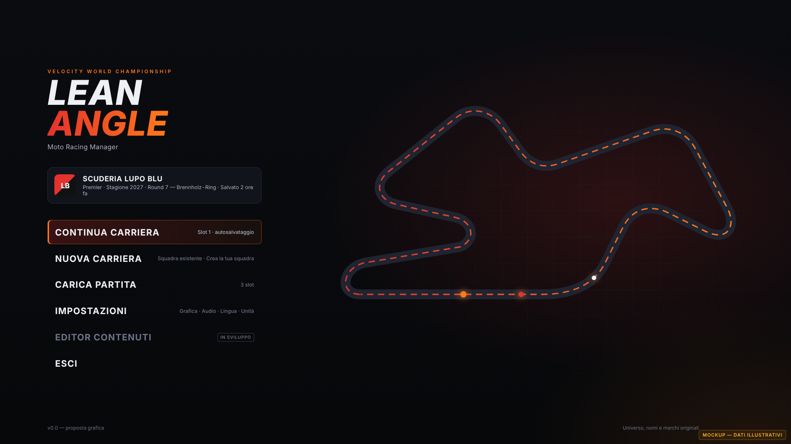

- A sinistra: marchio, scheda **"Continua"** con anteprima dell'ultimo
  salvataggio (squadra, stagione, round, quando), voci del menu.
- A destra: un circuito del gioco disegnato dai **dati reali del
  tracciato** con moto animate (nel gioco: un replay a bassa velocità di
  una gara simulata in background).
- Voci: Continua carriera · Nuova carriera (Squadra esistente / Crea la
  tua squadra) · Carica partita · Impostazioni · Esci. Funzioni non
  ancora pronte appaiono disabilitate con etichetta **"In sviluppo"**,
  mai come pulsanti attivi.
- Navigazione completa da tastiera e controller (frecce + Invio).

### Flusso "Nuova carriera"

1.  Modalità (squadra esistente / crea squadra)
2.  Categoria di partenza (Lightweight · Intermediate · Premier)
3.  Scelta squadra con confronto: budget, moto, piloti, obiettivi della
    dirigenza, difficoltà stimata — oppure procedura guidata di
    creazione (identità → tipologia → costruttore → piloti → staff →
    sponsor → riepilogo)
4.  Opzioni: nome carriera, seme del mondo (opzionale), difficoltà,
    autosalvataggio
5.  Generazione del mondo con barra di avanzamento (simulazione delle
    stagioni storiche)

## 3. Dashboard (Panoramica)

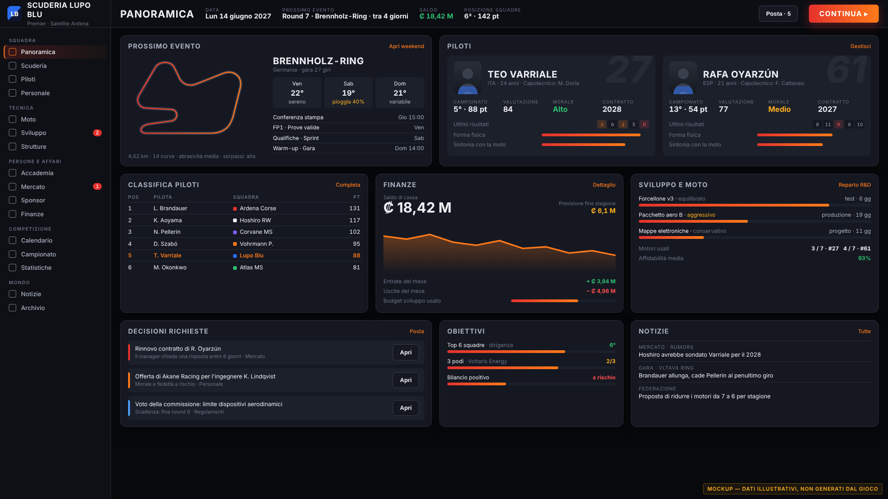

**Struttura della shell (comune a tutte le schermate)**

- **Sidebar** con le 16 voci richieste, raggruppate: *Squadra*
  (Panoramica, Scuderia, Piloti, Personale) · *Tecnica* (Moto, Sviluppo,
  Strutture) · *Persone e affari* (Accademia, Mercato, Sponsor, Finanze)
  · *Competizione* (Calendario, Campionato, Statistiche) · *Mondo*
  (Notizie, Archivio). I badge numerici indicano azioni in sospeso.
- **Top bar**: titolo schermata, data di gioco, prossimo evento, saldo,
  posizione squadre, posta, e il pulsante primario **Continua** che
  avanza il tempo fino al prossimo evento o decisione obbligatoria (come
  nei manageriali sportivi).

**Widget della Panoramica**

| Widget              | Contenuto                                                                                                | Fonte dati                            |
|---------------------|----------------------------------------------------------------------------------------------------------|---------------------------------------|
| Prossimo evento     | mappa circuito, caratteristiche, previsioni meteo con incertezza, programma sessioni                     | `Round`, `Circuit`, `WeatherForecast` |
| Piloti              | posizione, punti, valutazione, morale, contratto, ultimi 5 risultati, forma fisica, sintonia con la moto | `Rider`, `Standing`, `SessionResult`  |
| Classifica          | prime posizioni + riga della propria squadra evidenziata                                                 | `Standing`                            |
| Finanze             | saldo, andamento cassa, previsione di fine stagione, entrate/uscite del mese                             | `Transaction`, `FinanceForecast`      |
| Sviluppo e moto     | progetti R&D attivi con fase e tempi, motori usati / limite, affidabilità                                | `RnDProject`, `Bike`, `Regulation`    |
| Decisioni richieste | elementi della posta che bloccano l'avanzamento o hanno scadenza                                         | `InboxItem`                           |
| Obiettivi           | dirigenza, sponsor, costruttore con stato                                                                | `Objective`                           |
| Notizie             | ultime notizie e rumors generati dagli eventi                                                            | `NewsItem`                            |

## 4. Weekend di gara — vista 2D

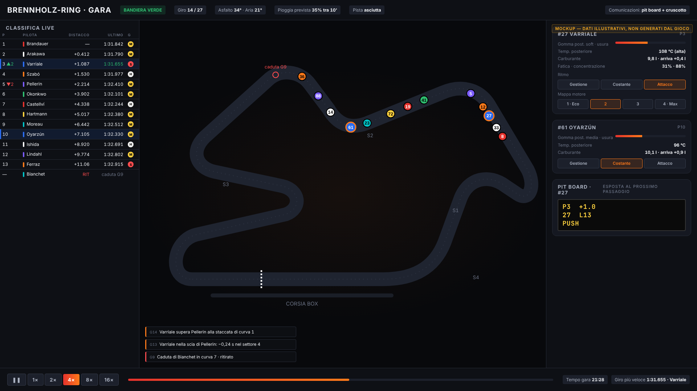

- **Sinistra**: classifica live con distacchi, ultimo giro, mescola,
  guadagni/perdite di posizioni; i piloti della squadra sono
  evidenziati.
- **Centro**: mappa 2D dall'alto disegnata dal tracciato del circuito,
  settori, corsia box, moto numerate nei colori delle squadre,
  segnalazione di cadute; feed degli eventi prodotti dalla simulazione.
- **Destra**: un pannello per pilota (usura e temperatura gomme,
  carburante con margine all'arrivo, fatica e concentrazione) e i
  comandi consentiti dal regolamento: ritmo, mappa motore, **pit board**
  con anteprima del messaggio.
- **Barra inferiore**: pausa, 1×, 2×, 4×, 8×, 16×, avanzamento gara,
  giro più veloce.

## 5. Scheda pilota

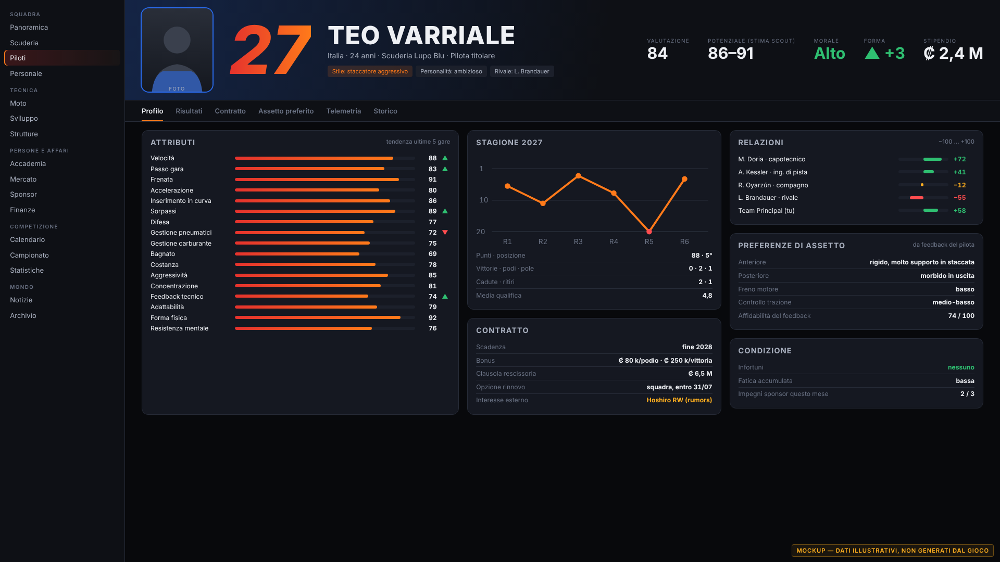

Intestazione con numero, valutazione, **potenziale stimato come
intervallo** (dipende dagli scout), morale, forma, stipendio. Schede:
Profilo, Risultati, Contratto, Assetto preferito, Telemetria, Storico.
Nel profilo: i 17 attributi con tendenza, andamento della stagione,
contratto e clausole, relazioni con staff/compagno/rivali, preferenze di
assetto ricavate dal feedback, condizione fisica.

## 6. Altre schermate chiave (linee guida)

- **Tabelle**: intestazioni fisse, ordinamento, filtri salvabili,
  colonne configurabili, virtualizzazione oltre 100 righe, confronto di
  due righe.
- **Schede persona**: intestazione con numero/ruolo, attributi a barre
  con valore e tendenza (▲▼), storico, contratto, relazioni.
- **Weekend di gara**: layout a tre colonne — cronometraggio a sinistra,
  mappa 2D al centro, controlli piloti e telemetria a destra; barra
  delle velocità (pausa, 1×, 2×, 4×, 8×, 16×) in basso.
- **Telemetria**: grafici a traccia sovrapposta per distanza (velocità,
  gas, freno, piega), delta-tempo, confronto pilota A/B, selettore giro.

## 7. Accessibilità

Contrasto minimo AA sul testo, stati mai indicati solo dal colore,
dimensione testo regolabile, modalità per daltonici sui colori di gomme
e squadre, riduzione animazioni.

# ADR-0001 — Stack tecnologico

- **Stato**: Proposto (in attesa di approvazione)
- **Data**: 2026-11-01

## Contesto

Manageriale con UI molto densa di dati, simulazione deterministica come
nucleo, distribuzione su PC, costi contenuti, sviluppo in ambiente cloud
senza editor grafici, futura vista 3D.

## Decisione

TypeScript in un monorepo a workspace npm; logica e simulazione in
pacchetti puri eseguiti in un Web Worker; interfaccia React + Vite;
vista di gara Canvas 2D dietro l'interfaccia `RaceRenderer`; contenitore
desktop Tauri 2; test con Vitest e Playwright.

## Alternative considerate

- **Godot 4**: ottimo e gratuito, ma UI gestionali (tabelle, grafici,
  filtri) richiedono molto lavoro manuale; test e CI meno immediati
  senza editor.
- **Unity**: forte su 3D, ma licenze e dipendenza dall'editor; UI dati
  non superiore al web.
- **Unreal Engine**: sovradimensionato per un manageriale; UI gestionali
  onerose; royalty.
- **Electron** al posto di Tauri: più semplice, ma installer ~10 volte
  più pesanti e consumo di memoria maggiore.

## Conseguenze

- (+) Velocità di sviluppo della UI, test rapidi, CI semplice, costi
  nulli, pacchetti leggeri.
- (+) La simulazione è riutilizzabile (CLI, strumenti di bilanciamento,
  eventuali server).
- (−) 3D di alto livello più limitato: mitigato dal formato di replay
  neutrale (`RaceFrame`).
- (−) WebView diverse per sistema operativo: test e2e su
  Windows/macOS/Linux in CI prima dei rilasci.

# ADR-0002 — Stato di gioco e persistenza

- **Stato**: Proposto (in attesa di approvazione)
- **Data**: 2026-11-01

## Contesto

Il gioco deve simulare un mondo intero (squadre, persone, contratti,
gare) e salvare carriere pluriennali con storico e statistiche.

## Decisione

- Stato corrente come **database relazionale in memoria** normalizzato
  (`Record<Id, Entity>` per tabella).
- Modifiche solo tramite **comandi** validati e **sistemi** che emettono
  **eventi di dominio**.
- **PRNG con seme** (`sfc32`) diviso in flussi per sottosistema, salvato
  con lo stato.
- Salvataggi: `meta.json` + `state.json.gz` + archivio per stagione, con
  `schemaVersion` e migrazioni.
- Adapter di storage: filesystem via Tauri (desktop), IndexedDB
  (sviluppo nel browser).

## Alternative considerate

- **SQLite come stato primario**: query potenti, ma la simulazione
  richiede comunque lo stato in memoria; il doppio modello aumenta
  complessità e tempi di avanzamento. Riconsiderato per il solo archivio
  statistico se supera ~50 MB per carriera.
- **ECS** (Entity Component System): utile per migliaia di entità in
  tempo reale; qui le entità sono poche centinaia/migliaia e prevalgono
  le relazioni, quindi un modello relazionale è più chiaro.

## Conseguenze

- (+) Determinismo, replay, riproducibilità dei bug, test golden.

- (+) Salvataggio/caricamento semplici e veloci.

- (−) Lo storico cresce: archiviazione per stagione e caricamento su
  richiesta.

# Appendice — Galleria screenshot

Tutte le immagini sono mockup HTML renderizzati con Chromium; i dati
sono illustrativi.


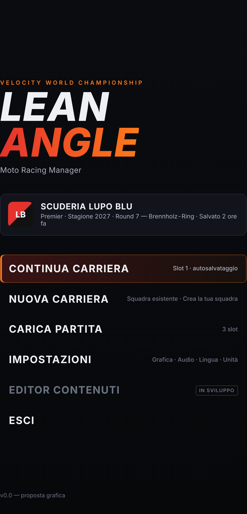

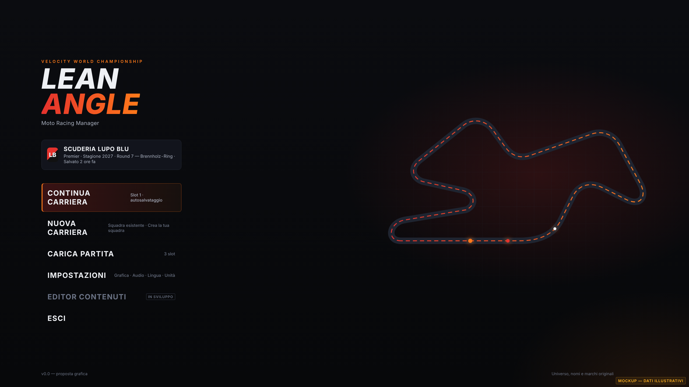

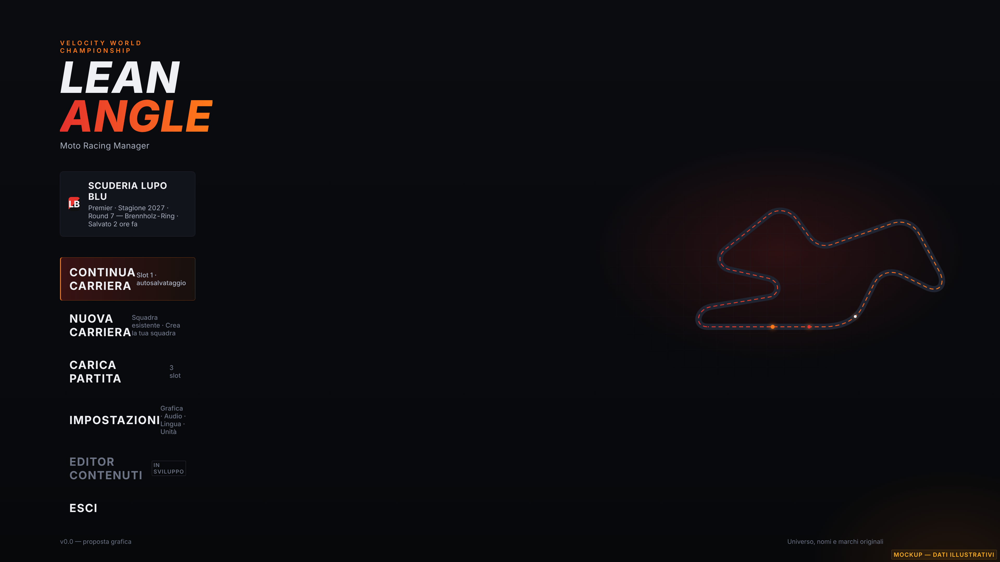


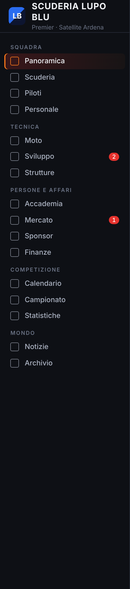


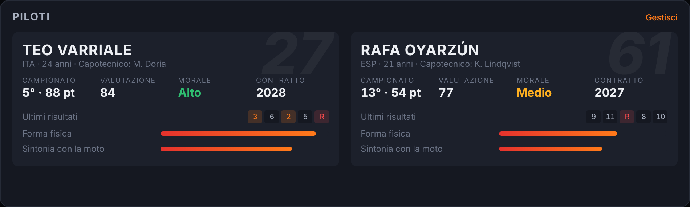


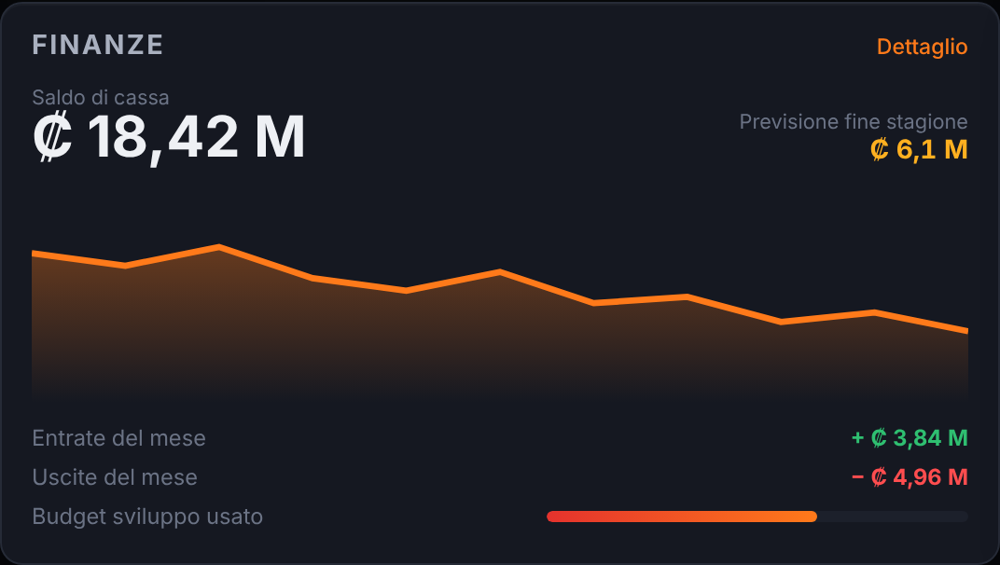

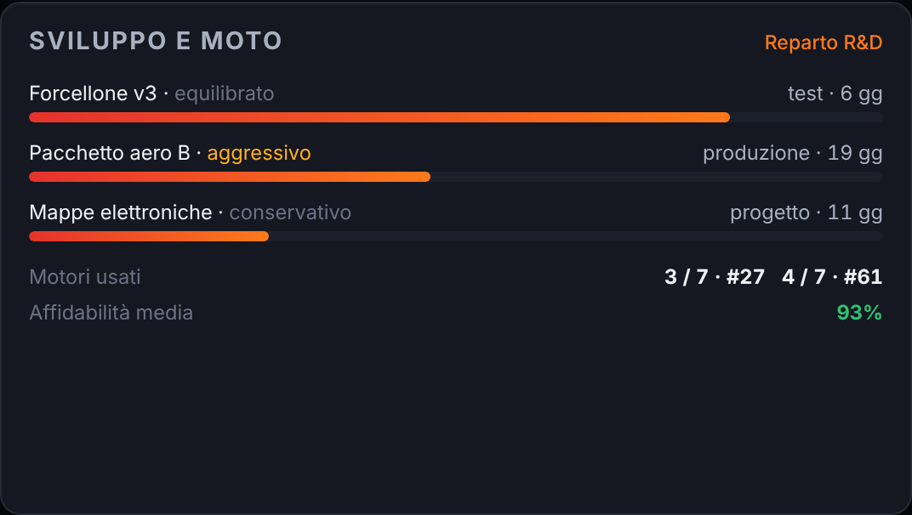

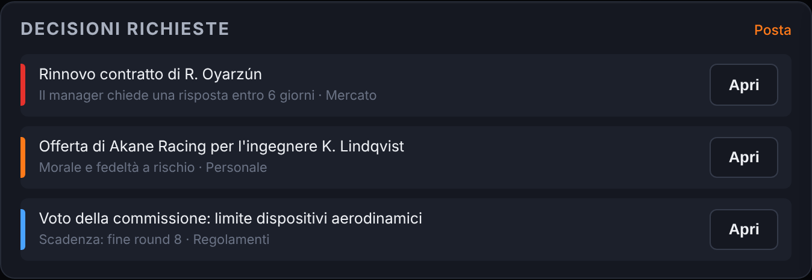

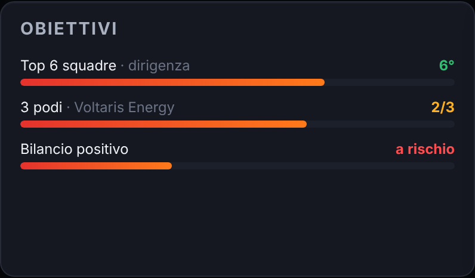

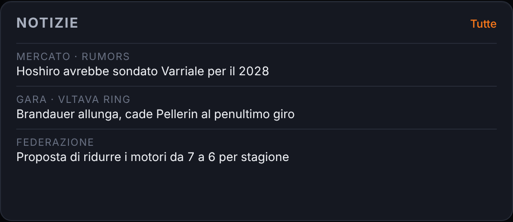

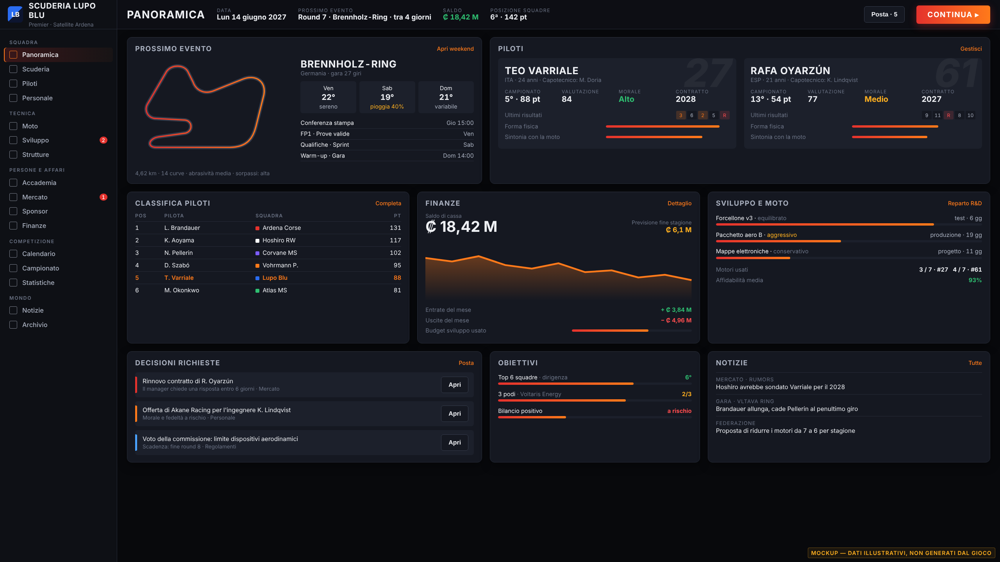

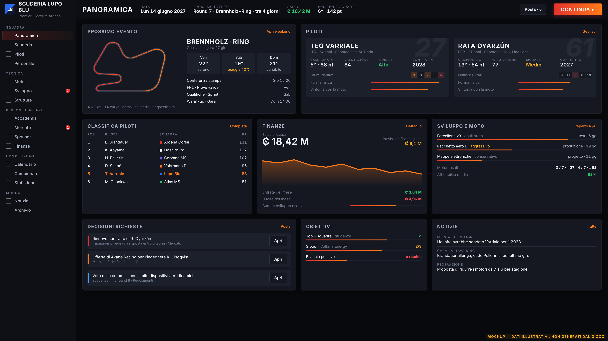


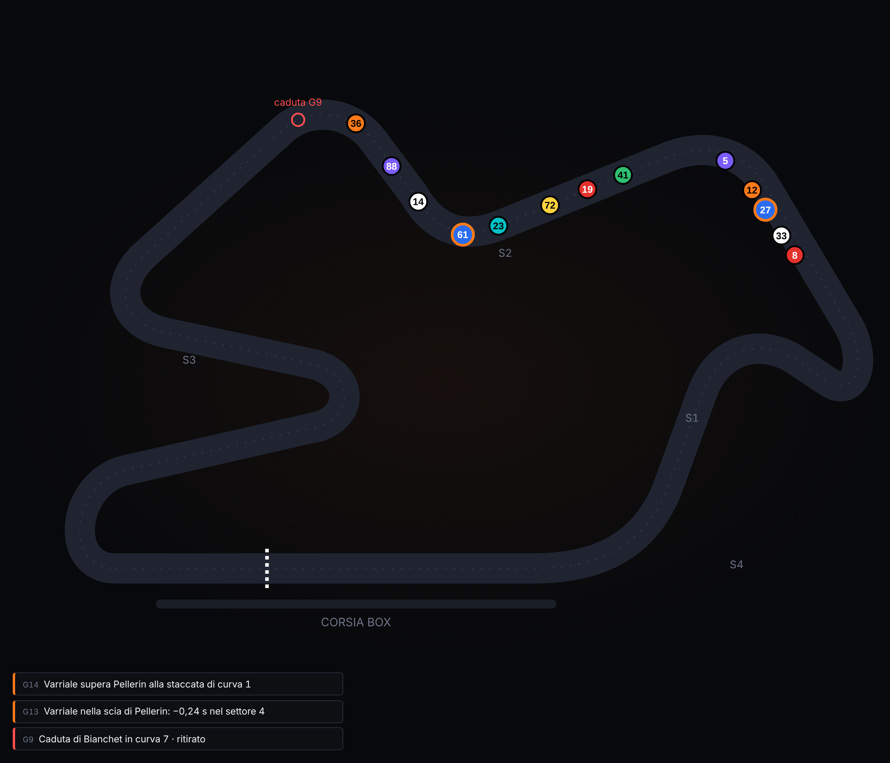

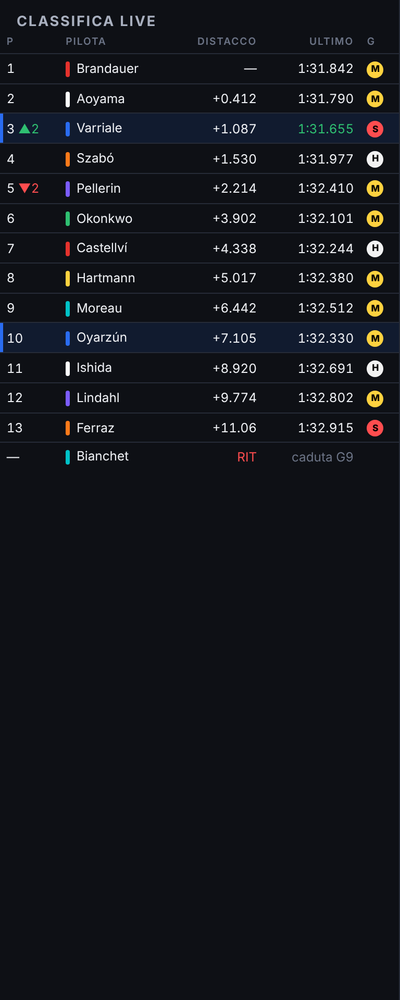

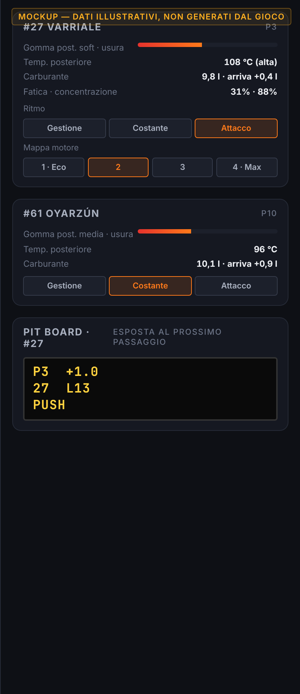


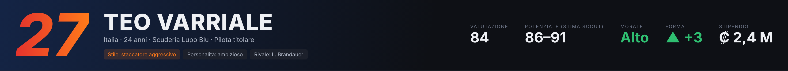

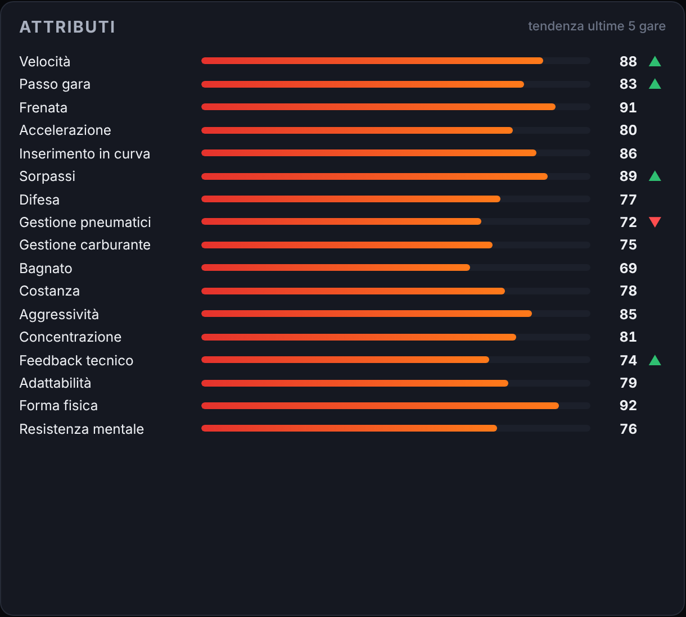

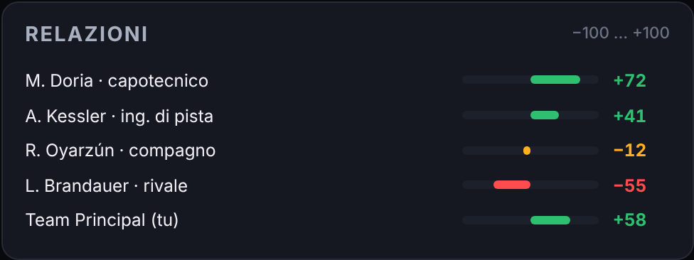

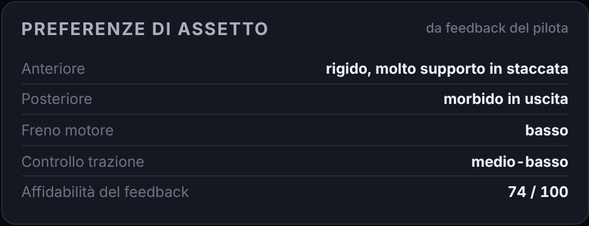
